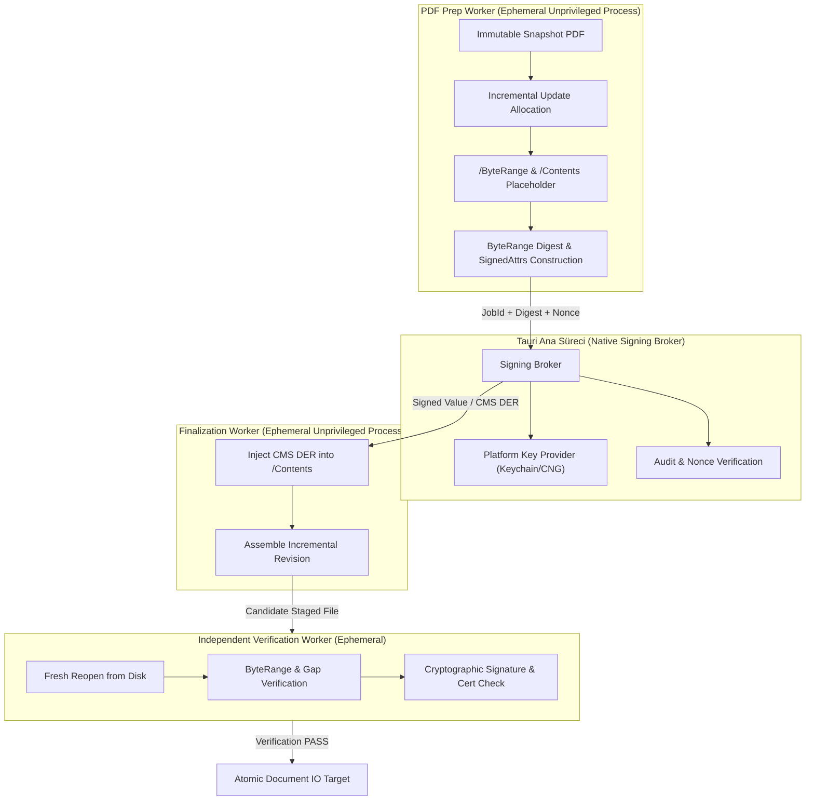

# PAdES ve Dijital İmza Mimari Tasarım Belgesi

**Belge Sürümü:** 1.2.0 (Kapı 2 / Prompt 10A Nihai Acceptance Closure)  
**Tarih:** 2026-08-16  
**Durum:** Onaylanmış Tasarım Belgesi — Üretim İmplementasyonu Öncesi Kanonik Mimari Otorite  

---

## 1. Yönetici Özeti ve Mimari İlkeler

Antigravity PDF Reader, Tauri v2 ve Rust tabanlı bir masaüstü uygulamasıdır. Bu belgenin amacı, ETSI EN 319 142-1 (PAdES) standardı, ISO 32000-1 / 32000-2 PDF spesifikasyonları ve RFC 5652 (CMS) kriptografik standartları ile tam uyumlu, güvenli, doğrulanabilir ve bağımsız olarak denetlenebilir bir dijital imza altyapısının uçtan uca mimarisini tanımlamaktır.

> [!IMPORTANT]
> **Kanonik Doğrulayıcı İlkesi**:
> Hiçbir harici araç veya kütüphane (EU DSS dahil) "kanonik doğrulayıcı" veya "kanonik üretim referansı" olarak adlandırılamaz. Her araç yalnızca bağımsız bir birlikte çalışabilirlik ve referans oracledır.

### Temel Mimari Prensipler

1. **PDFium Kanonikliği ve Worker İzolasyonu**: PDFium uygulamanın render, text extraction ve geometri otoritesidir. Tüm kullanıcı PDF ayrıştırma ve hazırlık işlemleri ephemeral, unprivileged worker süreçlerinde ve immutable snapshot'lar üzerinde yürütülür. Ana Tauri süreci doğrudan kullanıcı PDF'i ayrıştırmaz.
2. **`lopdf` Rolü ve Sınırları**: `lopdf` bir render motoru değildir. Yalnızca açıkça tanımlanmış yapısal PDF analizi, xref tarama, imza sözlüğü (`/Type /Sig`), `/ByteRange`, `/Contents`, `/DSS`, `/VRI` ve artımlı revizyon analizi gibi yardımcı yapısal görevlerde ("*Auxiliary PDF structure library; capability-specific use only*") sınırlandırılmıştır. Asla PDFium'un render/geometri otoritesinin yerine geçirilemez ve aktif kullanıcı dosyasını doğrudan açamaz.
3. **Özel Anahtar Güvenliği ve Split-Phase Mimarisi (Model C)**: Özel anahtarlar (private keys) veya kriptografik donanım modülleri (HSM / Smart Card / Secure Enclave) asla PDF ayrıştırma worker'larına verilmez. İmzalama süreci iki faza bölünür: (a) Worker belgeden ByteRange özetini ve imzalanacak nitelikleri (signed attributes) hazırlar, (b) Native Signing Broker platform anahtar sağlayıcısı üzerinden yalnız özeti imzalar, (c) Finalization worker CMS paketini hedef PDF'e yerleştirir.
4. **Tek "is_valid" İllüzyonunun Reddi**: Kriptografik doğrulama asla tek bir boolean (`is_valid: true/false`) veya tek bir yeşil onay kutusuna indirgenemez. Doğrulama; yapısal bütünlük, ByteRange kapsamı, kriptografik özet eşleşmesi, sertifika zinciri, zaman damgası ve iptal (revocation) kanıtlarını içeren zengin ve tipli bir rapor (`PdfSignatureVerificationReport`) üretir.
5. **Zorunlu İmza Sonrası Bağımsız Doğrulama (Verification-After-Signing)**: Bir imzanın başarıyla atılmış sayılması CMS'in bayt alanına yazılması ile tamamlanmaz. Dosya diske atomik olarak yazılmadan önce bağımsız bir doğrulama sürecinden geçirilir; imza geçerliliği, ByteRange bütünlüğü ve incremental revizyon yapısı onaylanmadan harici dosya sistemine yayınlanmaz.
6. **Atomik Yayın ve Dayanıklılık**: İmzalanan veya LTV uygulanan PDF belgelerinin diske yazılması `document_io.rs` ve `sanitization_publication.rs` standartlarına birebir uygun olarak, geçici dosya izolasyonu, hedef doğrulama, atomik rename ve dizin senkronizasyonu ile gerçekleştirilir.

---

## 2. Standartlar, Modeller ve Temel Soyutlamalar

### §2.1 Düzeltilmiş ETSI Normatif Kaynaklar Tablosu

Tüm normatif standartlar, ETSI Work Programme / Publications kayıtları ve resmi deliver dizinleri üzerinden doğrulanmıştır:

| Belge | Latest Published Version | Publication Date | Previous / Superseded Versions | Work Item Reference | Intended Target Deliverable Version | Current Uploaded Draft Version | Current Work Item Status | Status Date | Next Work Item Status | Design Baseline | Authoritative Evidence | Research Date |
|---|---|---|---|---|---|---|---|---|---|---|---|---|
| **ETSI EN 319 142-1** | **V1.2.1** | **2024-01-18** | V1.1.1 (2016-04) | `REN/ESI-0019142-1v131` | `EN 319 142-1 V1.3.1` | `1.2.9 Draft` | **Final draft** | **2026-07-07** | *Final draft endorsed by the Technical Group* | **V1.2.1** (Published canonical standard) | ETSI Deliver Directory: `31914201/01.02.01_60/` & Work Programme STF705 D5.11 | 2026-08-16 |
| **ETSI EN 319 142-2** | **V1.2.1** | **2025-07-01** | V1.1.1 (2016-04-12) | *None found* | — | — | *None* | — | — | **V1.2.1** (Published canonical standard; TS 102 778 P2–6 yerine geçer) | ETSI Deliver Directory: `31914202/01.02.01_60/` & ETSI Publications Archive | 2026-08-16 |
| **ETSI EN 319 102-1** | **V1.4.1** | **2024-06-20** | V1.3.1 (2021-11), V1.1.1 (2016-05) | `REN/ESI-0019102-1v151` | `EN 319 102-1 V1.5.1` | `1.4.2 Draft` | **Stable draft** | **2026-06-03** | — | **V1.4.1** (Published canonical standard; AdES imza oluşturma ve doğrulama prosedürleri) | ETSI Deliver Directory: `31910201/01.04.01_60/` & Work Programme STF705 D5.9 | 2026-08-16 |
| **ETSI TS 119 102-2** | **V1.4.1** | **2023-06-05** | V1.3.1 (2021-08), V1.2.1 (2019-06), V1.1.1 (2016-05) | `REN/ESI-0019102-2v151` | `EN 319 102-2 V1.5.1` | `1.4.3 Draft` | **Stable draft** | **2026-06-29** | — | **TS 119 102-2 V1.4.1** (Published canonical TS; imza doğrulama raporu veri modeli) | ETSI Deliver Directory: `11910202/01.04.01_60/` & Work Programme STF705 D5.10 | 2026-08-16 |
| **ETSI EN 319 122-1** | **V1.3.1** | **2023-06-28** | V1.1.1 (2016-04) | *None found* | — | — | *None* | — | — | **V1.3.1** (Published canonical standard; CAdES SignedAttributes formatı) | ETSI Deliver Directory: `31912201/01.03.01_60/` & ETSI Publications Archive | 2026-08-16 |
| **ISO 32000-1** | **2008** | — | — | ISO TC 171/SC 2 | ISO 32000-2 | — | **Published** | 2008-07-01 | — | **ISO 32000-1:2008** (PDF 1.7 / ByteRange / Incremental Update) | ISO Standards Directory (ISO 32000-1:2008) | 2026-08-16 |
| **ISO 32000-2** | **2020** | — | ISO 32000-2:2017 | ISO TC 171/SC 2 | — | — | **Published** | 2020-12-14 | — | **ISO 32000-2:2020** (PDF 2.0 / Modern imza yapıları, SHA-3, PAdES) | ISO Standards Directory (ISO 32000-2:2020) | 2026-08-16 |
| **RFC 5652** | **STD 70** | 2009-09 | RFC 3852, RFC 3369 | IETF SMIME WG | — | — | **Internet Standard** | 2009-09 | — | **RFC 5652** (Cryptographic Message Syntax - CMS) | IETF RFC Repository | 2026-08-16 |
| **RFC 5035** | **Proposed STD** | 2007-08 | RFC 2634 (Sec 5 update) | IETF SMIME WG | RFC 5816 | — | **Proposed Standard** | 2007-08 | — | **RFC 5035** (Enhanced Security Services for S/MIME - ESSCertIDv2) | IETF RFC Repository | 2026-08-16 |
| **RFC 5816** | **Proposed STD** | 2010-04 | RFC 5035 (Update) | IETF SMIME WG | — | — | **Proposed Standard** | 2010-04 | — | **RFC 5816** (ESSCertIDv2 Updates for SHA-256 and Other Hash Algorithms) | IETF RFC Repository | 2026-08-16 |
| **RFC 3161** | **Proposed STD** | 2001-08 | — | IETF PKIX WG | RFC 5816 | — | **Proposed Standard** | 2001-08 | — | **RFC 3161** (Time-Stamp Protocol - TSP) | IETF RFC Repository | 2026-08-16 |
| **RFC 5280** | **Proposed STD** | 2008-05 | RFC 3280 | IETF PKIX WG | — | — | **Proposed Standard** | 2008-05 | — | **RFC 5280** (X.509 PKI Certificate and CRL Profile) | IETF RFC Repository | 2026-08-16 |
| **RFC 6960** | **Proposed STD** | 2013-06 | RFC 2560 | IETF PKIX WG | — | — | **Proposed Standard** | 2013-06 | — | **RFC 6960** (X.509 Online Certificate Status Protocol - OCSP) | IETF RFC Repository | 2026-08-16 |
| **RFC 8017** | **Informational** | 2016-11 | RFC 3447 | IETF CFRG | — | — | **Informational** | 2016-11 | — | **RFC 8017** (PKCS #1: RSA Cryptography Specifications Version 2.2) | IETF RFC Repository | 2026-08-16 |

---

### §2.2 Yetkili Kaynak Doğrulama Metodolojisi (Source Hierarchy)

Tüm standart ve yazılım sürümleri aşağıdaki katı hiyerarşiye göre doğrulanmıştır:

1. **Normatif Standartlar**:
   1. *ETSI Work Programme / Resmi Publications Portalı* (`portal.etsi.org` & `etsi.org/standards`)
   2. *ETSI Resmi Deliver Dizini* (`etsi.org/deliver/...`)
   3. *Yayımlanmış Standart PDF Başlık Sayfası ve Tarihçesi*
2. **EU DSS**:
   1. *European Commission Digital Building Blocks DSS Releases Portalı* (`ec.europa.eu/digital-building-blocks`)
   2. *Resmi DSS Dokümantasyonu (Cookbook / Javadoc)*
   3. *Resmi Kaynak Deposu ve Release Tag'leri* (`github.com/esig/dss`)
3. **Diğer Yazılım Araçları ve Kütüphaneler**:
   1. *Resmi Proje Sürüm Sayfası* (Örn: `poppler.freedesktop.org`, `verapdf.org`)
   2. *Resmi Kaynak Deposu Release Tag'leri* (`github.com/.../releases`)
   3. *Resmi Paket Kayıt Defteri* (`crates.io`, `pypi.org`, `Maven Central`)
   4. *Resmi Proje Dokümantasyonu*
4. **Çelişki Yönetimi (Conflict Handling)**:
   Birincil kaynaklar arasında çelişki tespit edildiğinde kesin hüküm verilmez; `SOURCE CONFLICT` olarak işaretlenip her iki kaynağın verisi ve nedeni açıkça belgelenir.

---

### §2.3 Capability Decomposition (18 Bağımsız Yetenek)

İmza motoru tek parça bir yapı değil, her biri ayrı doğrulanabilen ve test edilebilen 18 mikro-yeteneğe ayrılmıştır:

1. **CAP-01 (Signature Discovery)**: PDF xref tablosunu ve nesne ağacını tarayarak imza sözlüklerini (`/Type /Sig`), imza alanlarını (`/Subtype /Widget`, `/FT /Sig`) ve Document Timestamp (`/Subtype /DocTimeStamp`) nesnelerini keşfetme.
2. **CAP-02 (ByteRange Validation)**: `/ByteRange [offset1 len1 offset2 len2 ...]` dizisinin tam dosya sınırlarını kapsadığını, kesişme olmadığını, sıralı olduğunu ve `/Contents` hex/binary dizesini tam olarak dışladığını teyit etme.
3. **CAP-03 (Revision Analysis & Incremental Walk)**: Belgenin başlangıç sürümünden sonraki tüm artımlı (incremental) güncellemeleri ayrıştırıp her revizyonun hangi imza tarafından korunduğunu saptama.
4. **CAP-04 (Digest Calculation)**: ByteRange ile işaretlenen bayt akışının SHA-256 / SHA-384 / SHA-512 kriptografik özetini hesaplama.
5. **CAP-05 (CMS Parsing)**: `/Contents` içerisindeki DER kodlu PKCS#7 / CMS `SignedData` yapısını ayrıştırma (SignerInfo, DigestAlgorithms, Certificates, CRLs).
6. **CAP-06 (Signed Attribute Verification)**: `message-digest`, `signing-time`, `signing-certificate-v2` (RFC 5035 / RFC 5816), `content-type` niteliklerinin DER canonical düzenini ve belge özetiyle eşleşmesini doğrulama.
7. **CAP-07 (Cryptographic Signature Value Verification)**: SignerInfo içerisindeki imza değerini imzalayanın açık anahtarı ve seçilen algoritma (RSA-PKCS#1 v1.5, RSA-PSS, ECDSA) ile doğrulama.
8. **CAP-08 (Signer Certificate Extraction & Matching)**: CMS içerisindeki X.509 sertifikasını `SigningCertificateV2` niteliğindeki sertifika özeti ve issuer/serial ile birebir eşleştirme.
9. **CAP-09 (Trust Anchor & Path Validation)**: İmzalayan sertifikasından yerel/sistem güven köklerine (Trust Anchors) giden sertifika zincirini inşa etme ve X.509 uzantılarını (`KeyUsage`, `ExtendedKeyUsage`, `BasicConstraints`) doğrulama.
10. **CAP-10 (Revocation Checking - OCSP/CRL)**: İmza anında veya doğrulama anında sertifikanın durumunu DSS/VRI gömülü kanıtlarından veya çevrimiçi OCSP/CRL kaynaklarından teyit etme.
11. **CAP-11 (Timestamp Token Verification)**: Signature timestamp (`id-aa-signatureTimeStampToken`) ve Document timestamp (`/DocTimeStamp`) RFC 3161 jetonlarını, TSA sertifikasını ve zaman damgası özetini doğrulama.
12. **CAP-12 (DocMDP & Certification Permissions Check)**: Belgede `/DocMDP` (P=1 No changes, P=2 Form fill/Sign, P=3 Annotations) veya `/FieldMDP` kısıtlamalarının sonraki revizyonlarda ihlal edilip edilmediğini saptama.
13. **CAP-13 (PAdES Level Classification)**: İmzanın sağladığı kanıtlara göre PAdES B-B, B-T, B-LT veya B-LTA seviyesini kesin kriterlerle sınıflandırma.
14. **CAP-14 (Platform Identity & Key Discovery)**: İşletim sistemi güvenli anahtarlık (macOS Keychain, Windows Cert Store, PKCS#11) üzerinden imzalama kimliklerini listeleme.
15. **CAP-15 (Incremental Update Generator)**: İmzalanacak PDF'e orijinal baytları bozmadan yeni bir imza alanı (`/SigField`), imza sözlüğü (`/Sig`), `/ByteRange` ve `/Contents` placeholder'ı içeren yeni bir revizyon ekleme.
16. **CAP-16 (Detached CMS Construction)**: ETSI EN 319 142-1 B-B / B-T standartlarına tam uyumlu, DER kodlu `SignedData` CMS yapısını oluşturma.
17. **CAP-17 (DSS / VRI Injection)**: LTV (B-LT/B-LTA) için gerekli Document Security Store (`/DSS`) ve Validation-Related Information (`/VRI`) sözlüklerini artımlı güncelleme olarak yazma.
18. **CAP-18 (Independent Output Verifier)**: İmzalanan veya LTV uygulanan PDF dosyasını harici yayından önce bağımsız olarak açıp baştan sona doğrulayan otomatik kapı mekanizması.

---

### §2.4 Tipli Doğrulama Veri Modeli ve Rapor Şeması (Design-Only Contract)

ETSI TS 119 102-2 V1.4.1 standardına, kriptografik ayrışım ilkelerine ve sistem güvenlik mimarisine tam uyumlu tipli veri modeli:

```rust
// ============================================================================
// Kanonik Rapor Yapısı ve Durum Modeli (Design-Only Contract)
// ============================================================================

#[derive(Serialize, Deserialize, Debug, Clone)]
pub struct PdfSignatureVerificationReport {
    pub schema_version: u32,
    pub session_id: String,
    pub content_generation: u64,
    pub document_digest: String,              // SHA-256 of entire file
    pub total_signatures: u32,
    pub signatures: Vec<PdfSignatureReport>,
    pub document_modification_status: DocumentModificationStatus,
    pub certification_permission: Option<CertificationPermission>,
    pub global_findings: Vec<ValidationFinding>,
    pub verified_at_utc: String,              // ISO 8601
}

#[derive(Serialize, Deserialize, Debug, Clone)]
pub struct PdfSignatureReport {
    pub signature_id: String,
    pub field_name: String,
    pub byte_range: Vec<u64>,                 // [offset1, len1, offset2, len2]
    pub byte_range_status: ByteRangeStatus,
    pub cryptographic_integrity: CryptographicIntegrityStatus,
    pub document_modification: ModificationScope,
    pub signer_identity: SignerIdentityReport,
    pub claimed_signing_time: Option<String>, // ISO 8601 from /M or signing-time
    pub signature_timestamp: Option<TimestampReport>,
    pub document_timestamps: Vec<TimestampReport>,
    pub pades_detected_level: PadesLevel,
    pub pades_validated_level: PadesLevel,
    pub algorithm_policy: AlgorithmPolicyReport,
    pub revocation_status: RevocationStatus,
    pub trust_status: TrustChainStatus,
    pub findings: Vec<ValidationFinding>,
}

// ----------------------------------------------------------------------------
// Kanonik Durum Enumları (5'li Temel Aile)
// ----------------------------------------------------------------------------

#[derive(Serialize, Deserialize, Debug, Clone, PartialEq, Eq)]
#[serde(rename_all = "snake_case")]
pub enum CryptographicIntegrityStatus {
    Valid,
    Invalid,
    Indeterminate,
    UnsupportedAlgorithm,
    Malformed,
}

#[derive(Serialize, Deserialize, Debug, Clone, PartialEq, Eq)]
#[serde(rename_all = "snake_case")]
pub enum ByteRangeStatus {
    Valid,
    Invalid,
    Indeterminate,
}

#[derive(Serialize, Deserialize, Debug, Clone, PartialEq, Eq)]
#[serde(rename_all = "snake_case")]
pub enum TrustChainStatus {
    Trusted,
    Untrusted,
    Indeterminate,
    NotChecked,
}

#[derive(Serialize, Deserialize, Debug, Clone, PartialEq, Eq)]
#[serde(rename_all = "snake_case")]
pub enum RevocationStatus {
    Good,
    Revoked,
    Unknown,
    NotChecked,
    NetworkFailed,
    EvidenceExpired,
    MalformedEvidence,
}

#[derive(Serialize, Deserialize, Debug, Clone, PartialEq, Eq)]
#[serde(rename_all = "snake_case")]
pub enum DocumentModificationStatus {
    NoModifications,
    PermittedModificationsOnly,
    UnauthorizedModificationsDetected,
    Indeterminate,
}

#[derive(Serialize, Deserialize, Debug, Clone, PartialEq, Eq)]
#[serde(rename_all = "snake_case")]
pub enum CertificationPermission {
    NoChangesPermitted,              // DocMDP P=1
    FormFillAndSigningPermitted,     // DocMDP P=2
    FormFillSigningAndAnnotations,   // DocMDP P=3
}

#[derive(Serialize, Deserialize, Debug, Clone, PartialEq, Eq)]
#[serde(rename_all = "snake_case")]
pub enum ModificationScope {
    NoLaterRevision,
    LaterRevisionPermitted,
    LaterRevisionNotPermitted,
    LaterRevisionUnclassified,
    ByteRangeInvalid,
}

#[derive(Serialize, Deserialize, Debug, Clone, PartialEq, Eq)]
#[serde(rename_all = "snake_case")]
pub enum PadesLevel {
    None,
    PadesBB,
    PadesBT,
    PadesBLT,
    PadesBLTA,
}

// ----------------------------------------------------------------------------
// Algoritma Politikası ve Normatif Referans Modeli
// ----------------------------------------------------------------------------

#[derive(Serialize, Deserialize, Debug, Clone)]
pub struct AlgorithmPolicyReport {
    pub digest_policy: SingleAlgorithmPolicy,
    pub signature_policy: SingleAlgorithmPolicy,
    pub format_specifications: Vec<FormatSpecificationReference>,
}

#[derive(Serialize, Deserialize, Debug, Clone)]
pub struct SingleAlgorithmPolicy {
    pub algorithm_identifier: String,        // Örn: "SHA-256", "RSA-PSS-SHA384", "ECDSA-P256"
    pub policy_status: AlgorithmPolicyStatus,
    pub normative_references: Vec<AlgorithmStandardReference>,
}

#[derive(Serialize, Deserialize, Debug, Clone, PartialEq, Eq)]
#[serde(rename_all = "snake_case")]
pub enum AlgorithmPolicyStatus {
    Allowed,
    Deprecated,
    Disallowed,
    Indeterminate,
    NotEvaluated,
}

#[derive(Serialize, Deserialize, Debug, Clone, PartialEq, Eq)]
#[serde(rename_all = "snake_case")]
pub enum AlgorithmStandardReference {
    Fips186_5,        // NIST FIPS 186-5 (Digital Signature Standard)
    FipsPub180_4,     // NIST FIPS PUB 180-4 (Secure Hash Standard)
    NistSp800_186,    // NIST SP 800-186 (Elliptic Curve Curves)
    NistSp800_56a,    // NIST SP 800-56A (Pair-Wise Key-Establishment)
    Pkcs1v2_2,        // PKCS #1 v2.2 (RFC 8017)
    AnsiX9_62,        // ANSI X9.62 (ECDSA)
    Other(String),
    Unstandardized,
}

#[derive(Serialize, Deserialize, Debug, Clone, PartialEq, Eq)]
#[serde(rename_all = "snake_case")]
pub enum FormatSpecificationReference {
    Rfc5652Cms,              // Cryptographic Message Syntax (CMS)
    Rfc5280X509,             // X.509 PKI Certificate and CRL Profile
    EtsiEn319142_1Pades,     // PAdES Digital Signatures
    EtsiTs119102_2,          // Signature Validation Procedures
    Iso32000_1,              // PDF 1.7 Specification
    Iso32000_2,              // PDF 2.0 Specification
    Rfc3161Tsp,              // Time-Stamp Protocol
}

// ----------------------------------------------------------------------------
// Destekleyici Tipli Rapor Yapıları
// ----------------------------------------------------------------------------

#[derive(Serialize, Deserialize, Debug, Clone)]
pub struct SignerIdentityReport {
    pub common_name: String,
    pub organization: Option<String>,
    pub country: Option<String>,
    pub email: Option<String>,
    pub certificate_serial: String,
    pub certificate_issuer: String,
    pub certificate_validity_start: String,
    pub certificate_validity_end: String,
    pub certificate_sha256_fingerprint: String,
}

#[derive(Serialize, Deserialize, Debug, Clone)]
pub struct TimestampReport {
    pub timestamp_type: TimestampType,
    pub timestamp_time_utc: String,
    pub tsa_name: String,
    pub tsa_certificate_serial: String,
    pub timestamp_status: TimestampStatus,
    pub digest_algorithm: String,
}

#[derive(Serialize, Deserialize, Debug, Clone, PartialEq, Eq)]
#[serde(rename_all = "snake_case")]
pub enum TimestampType {
    SignatureTimestamp,  // id-aa-signatureTimeStampToken
    DocumentTimestamp,   // /DocTimeStamp revision
}

#[derive(Serialize, Deserialize, Debug, Clone, PartialEq, Eq)]
#[serde(rename_all = "snake_case")]
pub enum TimestampStatus {
    Valid,
    Invalid,
    Expired,
    UntrustedTsa,
    DigestMismatch,
    Indeterminate,
}

#[derive(Serialize, Deserialize, Debug, Clone)]
pub struct ValidationFinding {
    pub code: String,                // Örn: "DIGEST_MISMATCH", "UNCOVERED_GAP", "CHAIN_INCOMPLETE"
    pub severity: FindingSeverity,
    pub message: String,
    pub context: Option<String>,
}

#[derive(Serialize, Deserialize, Debug, Clone, PartialEq, Eq)]
#[serde(rename_all = "snake_case")]
pub enum FindingSeverity {
    Info,
    Warning,
    Error,
    Fatal,
}
```

---

### §2.5 Validation-Time Modeli

İmza doğrulamada zaman parametresi kritik bir güvenlik faktörüdür. Sistem aşağıdaki zaman katmanlarını birbirinden kesin olarak ayırır:

1. **Current System Time (`t_sys`)**: Doğrulamanın yapıldığı andaki işletim sistemi yerel saati. İptal kontrollerinde ve taze doğrulama işlemlerinde kullanılır.
2. **Claimed Signing Time (`t_claim`)**: CMS SignedData içerisindeki `signing-time` niteliğinden okunan beyan edilen zaman. **Güvenilmezdir**; imzalayan kişi sistem saatini manipüle etmiş olabilir.
3. **Trusted Signature Timestamp Time (`t_sig_ts`)**: CMS `id-aa-signatureTimeStampToken` içerisindeki RFC 3161 zaman damgası yetkilisinin (TSA) onayladığı kriptografik zaman. İmzanın bu tarihten önce var olduğunu kanıtlar.
4. **Document Timestamp Time (`t_doc_ts`)**: Belge revizyon zincirinde yer alan bağımsız `/DocTimeStamp` nesnesinden alınan zaman.
5. **Best Signature Time (`t_best`)**:
   - Eğer geçerli bir Signature Timestamp varsa: `t_best = t_sig_ts`
   - Yoksa: `t_best = t_claim` (güvensiz olarak işaretlenir)
6. **Historical Validation Time (`t_hist`)**: LTV doğrulamalarında, sertifikanın güvenilirliği ve iptal durumu `t_best` anına göre değerlendirilir (Geçmişte geçerli olan ancak bugün süresi dolmuş sertifikaların doğrulanabilmesi için).

---

### §2.6 PAdES Profil ve Seviye Matrisi (B-B / B-T / B-LT / B-LTA)

| Seviye | Yapısal Şartlar | Kriptografik Nitelikler | Zaman Damgası Gereksinimi | İptal & Güven Kanıtı |
|---|---|---|---|---|
| **PAdES B-B** (Basic) | ISO 32000-1 SubFilter `/ETSI.CAdES.detached`, `/Contents` hex-string | `signing-certificate-v2` veya `signing-certificate`, `message-digest`, `content-type` | İsteğe bağlı (`signing-time` niteliği taşır) | Yok (Çevrimiçi doğrulama anında taranır) |
| **PAdES B-T** (Timestamp) | PAdES B-B + RFC 3161 İmza Zaman Damgası | SignerInfo unsignedAttrs içinde `id-aa-signatureTimeStampToken` | **Zorunlu** RFC 3161 Signature Timestamp | Yok (Zaman damgası sertifikası doğrulanır) |
| **PAdES B-LT** (Long-Term) | PAdES B-T + Belge Düzeyinde DSS Sözlüğü | Tüm sertifika zincirleri, OCSP yanıtları veya CRL'ler `/DSS` sözlüğünde gömülü | Zorunlu (İmza ve DSS ekleme anı) | **Zorunlu Gömülü Kanıt** (Tüm zincir ve iptal verileri `/DSS` içinde) |
| **PAdES B-LTA** (Archive) | PAdES B-LT + Belge Düzeyinde Arşiv Zaman Damgaları | `/DSS` ve önceki tüm revizyonları kapsayan `/DocTimeStamp` revizyonu | **Zorunlu** Düzenli aralıklarla yenilenen Document Timestamp | Kriptografik algoritmaların eskimesine karşı tam arşiv bütünlüğü |

---

### §2.7 Sertifika ve Özel Anahtar Sağlayıcı Soyutlaması (Design-Only)

Özel anahtarlar belleğe asla ham bayt dizisi (raw private key) olarak aktarılmaz. Tüm kriptografik işlemler soyut arayüzler ve opaque tanıtıcılar (`handles`) üzerinden yürütülür:

```rust
pub trait CertificateProvider: Send + Sync {
    fn list_identities(&self) -> Result<Vec<SigningIdentity>, ProviderError>;
    fn acquire_key_handle(&self, identity_id: &str) -> Result<Box<dyn SigningKeyHandle>, ProviderError>;
}

pub trait SigningKeyHandle: Send + Sync {
    fn identity(&self) -> &SigningIdentity;
    fn sign_digest(&self, digest: &[u8], algorithm: SignatureAlgorithm) -> Result<Vec<u8>, ProviderError>;
    fn close(self: Box<Self>); // Zeroization and lock release
}
```

**Güvenlik Sınırları**:
- Özel anahtarlar asla WebView, JavaScript katmanı, PDF ayrıştırma worker'ı, loglar, hata mesajları veya işletim sistemi geçici dosyalarına sızdırılamaz.
- `SigningKeyHandle` yalnız özet (`digest`) imzalama çağrısını destekler; ham PDF içeriğini görmez.

---

### §2.8 Platform Sağlayıcı ve Destek Politikası

Platform mimarisinde üç ayrı kavram birbirinden ayrılmıştır:

1. **İşletim Sistemi API Mevcudiyeti**: Apple macOS 10.12+ (Sierra) / Windows Vista+ / Linux PKCS#11 v2.40+.
2. **Antigravity Sistem Tabanı**: Henüz resmi olarak ilan edilmemiştir (`NOT ESTABLISHED`).
3. **PAdES İlk Platform Hedefi**: Mimari ve implementasyon önceliği **`macOS arm64`** platformudur.

| Platform | Anahtar Deposu | API / Kütüphane | Donanım Entegrasyonu | PIN / Parola Akışı |
|---|---|---|---|---|
| **macOS (Öncelikli)** | Keychain (Login/System) | `Security.framework` (`SecIdentityCopyCertificate`, `SecKeyCreateSignature`) | Secure Enclave, CryptoTokenKit (SmartCard) | İşletim sistemi native GUI istemi (`LAContext` / Security UI) |
| **Windows (Planlanan)** | Windows Certificate Store | Microsoft Cryptography API: Next Generation (CNG / NCrypt) | Smart Card Minidriver, TPM Virtual Smart Card | Windows Security Dialog (NCrypt PIN UI) |
| **Linux (Planlanan)** | PKCS#11 / NSS | `cryptoki` / `libcrypto3` / `p11-kit` | PKCS#11 Donanım Jetonları, Soft-tokens | Pinentry / GCR Native Dialog |

---

### §2.9 PIN ve Kimlik Doğrulama Modeli

1. **Birinci Öncelik — Native OS UI**: PIN veya biyometrik doğrulama (Touch ID / Windows Hello / Token Prompt) işletim sisteminin güvenli kimlik doğrulama arayüzü üzerinden tetiklenir. Uygulama PIN'i doğrudan görmez.
2. **İkinci Öncelik — Donanım Jetonu PIN'i**: Kart okuyucunun kendi tuş takımı (PIN pad reader) varsa doğrudan donanım seviyesinde girilir.
3. **Üçüncü Öncelik — Backend-Native Güvenli Giriş**:
   - Eğer WebView dışı backend-native bir PIN girişi zorunlu olursa:
     - Bellekte `zeroize` özelliği olan tipler (`secrecy::SecretString`) kullanılır.
     - Bellek sayfaları kilitlenir (`mlock`), swap alanına yazılması engellenir.
     - Giriş alanı asla loglanmaz, kopyalanmaz (`Clone` yasak), serileştirilmez.
     - PIN girişi başarısız olduğunda token kilitleme (lockout) sayacı takip edilir.

---

## 3. Bağımlılık ve Aday Kütüphane Değerlendirmesi

### §3.1 Vendored PDFium Signature API Karakterizasyonu

Vendored PDFium header'ları (`src-tauri/include/fpdf_signature.h` ve ilgili public header'lar) taranmış ve aşağıdaki yetenek sınıflandırması oluşturulmuştur. Bu sınıflandırma kanıt standardına dayanmakta olup ilerideki implementasyon kararlarının normatif girdisidir.

**Mevcut Semboller (`fpdf_signature.h`):**

- `FPDF_GetSignatureCount`
- `FPDF_GetSignatureObject`
- `FPDFSignatureObj_GetContents`
- `FPDFSignatureObj_GetByteRange`
- `FPDFSignatureObj_GetSubFilter`
- `FPDFSignatureObj_GetReason`
- `FPDFSignatureObj_GetTime`
- `FPDFSignatureObj_GetDocMDPPermission`

**Vendored Public API'de Bulunmayan Semboller** (taranan diğer header'larda da yoktur):

- `FPDF_VerifySignature` veya eşdeğeri
- `FPDF_GetSignatureTrust`
- `FPDF_GetSignatureOCSP` / `FPDF_GetSignatureCRL`
- `FPDF_GetSignatureTimestamp` (RFC 3161)
- `FPDF_GetPAdESLevel`
- `FPDF_CreateSignature` veya `FPDF_Sign`

**Yetenek Sınıflandırması (Kanıt Standardı):**

| Yetenek | Durum | Kanıt / Gerekçe |
|---|---|---|
| Signature Discovery / Count | **SUPPORTED** | `FPDF_GetSignatureCount`, `FPDF_GetSignatureObject` mevcut |
| ByteRange Extraction | **SUPPORTED** | `FPDFSignatureObj_GetByteRange` mevcut |
| Contents / CMS Raw Data | **SUPPORTED** | `FPDFSignatureObj_GetContents` mevcut |
| SubFilter / Reason / Time | **SUPPORTED** | İlgili getter'lar mevcut |
| DocMDP Permission Inspection | **SUPPORTED** | `FPDFSignatureObj_GetDocMDPPermission` mevcut |
| PAdES B-B/B-T/B-LT/B-LTA Classification | **NOT AVAILABLE IN VENDORED PUBLIC API** | Doğrudan sınıflandırma API'si yoktur. **DocMDP, PAdES seviyesi sınıflandırması değildir**; yalnızca belge izinlerini gösterir. PAdES seviyesi sınıflandırması CAP-13 kapsamında `lopdf` + Rust crypto katmanında yapısal analiz ile gerçekleştirilmelidir. |
| Cryptographic Verification | **NOT AVAILABLE IN VENDORED PUBLIC API** | Doğrulama API'si yok; CAP-07 kapsamında RustCrypto (`rsa`, `p256/ecdsa`) ile yapılmalıdır. |
| Certificate Trust Validation | **NOT AVAILABLE IN VENDORED PUBLIC API** | Güven zinciri API'si yok; CAP-09 kapsamında platform API veya `x509-cert` ile yapılmalıdır. |
| OCSP / CRL Revocation | **NOT AVAILABLE IN VENDORED PUBLIC API** | İptal kontrol API'si yok; CAP-10 kapsamında `RevocationAndTimestampWorker`'da yapılmalıdır. |
| RFC 3161 Timestamp Validation | **NOT AVAILABLE IN VENDORED PUBLIC API** | Zaman damgası doğrulama API'si yok; CAP-11 kapsamında `cms` crate ile yapılmalıdır. |
| CMS / Signature Generation | **NOT AVAILABLE IN VENDORED PUBLIC API** | Oluşturma API'si yok; CAP-16 kapsamında `x509-cert / cms` crate ile yapılmalıdır. |

> [!IMPORTANT]
> **PARTIAL INPUT COVERAGE (PAdES sınıflandırması için)**: ByteRange, SubFilter, Time, DocMDP gibi ham yapısal girdiler PDFium vendored API'de mevcuttur; ancak bu girdiler **tek başına PAdES seviyesi belirlemez**. PAdES B-B/B-T/B-LT/B-LTA sınıflandırması, bu girdilerle birlikte DSS/VRI varlığı, RFC 3161 token içeriği ve CMS iç yapısının `lopdf` + `cms` katmanında ayrıştırılmasını gerektirir. DocMDP belge izni (P=1/2/3), PAdES seviyesi sınıflandırması değildir; ikisi birbirinin yerine kullanılamaz.

---

### §3.2 Mevcut Dependency Capability Matrisi

Her gereksinim için mevcut dependency / altyapı kapsamı, eksikler ve riskler aşağıda listelenmiştir. İddialar mevcut `Cargo.toml`, `Cargo.lock` ve kaynak kodu incelemesinden türetilmiştir.

| Gereksinim | Mevcut Destek | Eksik Parçalar | Risk / Sınırlama |
|---|---|---|---|
| **Signature Discovery** (CAP-01) | PDFium: `FPDF_GetSignatureCount`, `FPDF_GetSignatureObject`; `lopdf`: xref + object-tree traversal | — | PDFium yalnızca `Sig` türü widget alanlarını sayar; `lopdf` yapısal tarama ile tüm imza türleri (DocTimeStamp dahil) tespit edilebilir |
| **Signature Dictionary Inspection** (CAP-01/02) | PDFium: `FPDFSignatureObj_GetContents`, `FPDFSignatureObj_GetByteRange`, `FPDFSignatureObj_GetSubFilter`, `FPDFSignatureObj_GetTime`; `lopdf`: `/ByteRange`, `/Contents`, `/SubFilter` doğrudan nesne erişimi | — | PDFium API'si karakterizasyon tablosundaki sınırlar dahilindedir |
| **Incremental PDF Update** (CAP-03/15) | `lopdf` `0.34`: artımlı güncelleme yazma desteği (`IncrementalDocument`); sha2 + document_io.rs atomic pipeline | Yeni imza alanı placeholder boyutu ve ByteRange hesabı implementasyonu | `lopdf` v0.34 artımlı update desteği mevcut; CMS placeholder boyutu ve ByteRange senkronizasyonu iş öğesidir |
| **ByteRange Parsing / Generation** (CAP-02/15) | PDFium: `FPDFSignatureObj_GetByteRange`; `lopdf`: array nesnesi parse; `sha2`: özet hesabı | ByteRange gap ve out-of-bounds doğrulama mantığı | CAP-02 doğrulama kuralları ayrı Rust mantığı gerektirir |
| **CMS Parse** (CAP-05) | Aday: `x509-cert / cms` `0.2+` (RustCrypto); `lopdf`: raw DER bayt erişimi | `cms` crate'in Cargo.toml'a eklenmesi; `SignedData` tam ayrıştırma testi | Eklenmemiş aday; ekleme onayı gereklidir |
| **CMS Generation** (CAP-16) | Aday: `x509-cert / cms` `0.2+` | Crate eklenmesi; DER encoding testi | Aday crate |
| **X.509 Parse** (CAP-08/09) | Aday: `x509-cert` `0.2+` (RustCrypto) | Crate eklenmesi | Aday crate |
| **Certificate Path Validation** (CAP-09) | macOS: `Security.framework` (`SecTrustEvaluateWithError`); Win (planlanan): CNG; Linux: `cryptoki` / `p11-kit` (planlanan) | Windows/Linux implementasyonu gelecek fazda (P9) | macOS öncelikli platform; diğerleri P9'da |
| **Algorithm Policy** (CAP-07) | `sha2 =0.10.9`; Aday: `rsa 0.9+`, `p256/ecdsa 0.13+` | SHA-1/MD5 engelleme mantığı; algorithm policy enforcement | Forbidden algorithm listesi Rust'ta ayrı kural olarak implemente edilmeli |
| **OCSP / CRL** (CAP-10) | `reqwest` (ağ; mevcut); `RevocationAndTimestampWorker` (tasarımda) | OCSP/CRL response parser; network policy enforcement (SSRF koruması, redirect limiti, 100 KB body limit) | Mevcut `reqwest` yapılandırması; SSRF ve body limit Prompt 9 politikasına göre ayrıca implemente edilmeli |
| **RFC 3161 Timestamp** (CAP-11) | Aday: `cms` crate `TimeStampToken` parsing | TSA HTTP request + response validation implementasyonu | Aday crate; ağ politikası gerekli |
| **DSS / VRI Injection** (CAP-17) | `lopdf`: PDF nesne yazma; artımlı güncelleme | `/DSS`, `/Certs`, `/OCSPs`, `/CRLs`, `/VRI` sözlük oluşturma mantığı | `lopdf` structural write API kullanılabilir |
| **Archive Timestamp** (CAP-17/18) | Aday: `cms` + TSA entegrasyonu (B-LTA fazı) | `/DocTimeStamp` artımlı revizyon oluşturma | P8 fazı kapsamı |
| **Platform Certificate Store** (CAP-14) | macOS: `Security.framework` (`SecIdentityCopyCertificate`, listeleyici); Windows: CNG (planlanan); Linux: PKCS#11 (planlanan) | Windows/Linux fazları | macOS arm64 öncelikli |
| **Private-Key Signing** (CAP-14) | macOS: `SecKeyCreateSignature` (Secure Enclave dahil); Windows: NCrypt (planlanan); Linux: PKCS#11 (planlanan) | Windows/Linux fazları | Özel anahtar hiçbir zaman worker'a verilmez; yalnız broker imzalar |
| **PKCS#11** (CAP-14) | Aday: `cryptoki 0.6+` (gelecek faz P9) | Crate eklenmesi; donanım token test altyapısı | P9 kapsamı |
| **Independent Output Verification** (CAP-18) | Tasarımda: `SignatureVerificationWorker` ephemeral process | Implementasyonu; ByteRange + CMS + sertifika doğrulama akışı | Tasarım mevcut; implementasyon P1/P2 fazlarında |
| **Atomic Output Publication** | `document_io.rs` mevcut: adjacent-temp / atomic-rename / digest-bound / fsync | Signature output'unun `document_io.rs` pipeline'ına bağlanması | Altyapı mevcut; bağlantı implementasyonu iş öğesi |
| **Worker / Job / Atomic-Publication Altyapısı** | `--run-job-worker` ephemeral process pattern mevcut (OCR, sanitization vb.); `SessionJobChildProcessOwner`; bounded timeout; cancel/kill | Signature-spesifik worker komutları (`SignaturePrepWorker`, `SignatureFinalizationWorker`) implementasyonu | Worker pattern mevcut ve kanıtlanmış; signature komutları eklenmesi iş öğesi |
| **Platform API Abstraction** | `CertificateProvider` / `SigningKeyHandle` trait soyutlaması (tasarımda) | Trait implementasyonu macOS için (`Security.framework` FFI) | Tasarım mevcut; implementasyon P3 fazında |

> [!NOTE]
> Tüm "Aday crate" kategorisindeki kütüphaneler (`x509-cert/cms`, `rsa`, `p256/ecdsa`, `cryptoki`) Cargo.toml'a **eklenmeden önce açık onay gerektirir** (AGENTS.md mimari sınırı). Mevcut kod tabanına dahil değildir; bu tablo yalnızca yetenek değerlendirmesi içindir.

---

### §3.3 Onaylı Kütüphane Kataloğu

| Kütüphane / Crate / Araç | Sürüm (Cargo.toml / Lockfile) | Lisans | Bakım Durumu | Platform Desteği | Kripto & Bellek Güvenliği | Native Bağımlılık & Unsafe | FIPS Uyumu (Algoritma vs Modül) | Rolü ve Mimari Sınırları | Karar / Gerekçe |
|---|---|---|---|---|---|---|---|---|---|
| **pdfium-render** | `0.8` / `0.8.37` | MIT / Apache-2.0 | Aktif | macOS, Win, Linux | Yüksek (Google PDFium C++ sarmalayıcı) | C++ Dinamik Kütüphane (`libpdfium`); FFI unsafe | Module FIPS: NOT CLAIMED | **Kanonik PDF render, text extraction ve geometri otoritesi.** CMS imza yazma desteği yoktur. | **Mevcut (Kanonik).** Render ve geometri için tek yetkili. |
| **lopdf** | `0.34` / `0.34.0` | MIT | Aktif | Saf Rust (Tüm platformlar) | Orta (Bellek içi nesne ağacı) | Saf Rust; no native deps | Module FIPS: NOT CLAIMED | **Auxiliary PDF structure library; capability-specific use only.** Render motoru değildir. Sadece xref, imza sözlükleri, `/DSS` ve artımlı revizyon analizi için kullanılır. | **Mevcut (Auxiliary).** Sıkı izinli yapısal görevlerde sınırlı kullanım. |
| **sha2** | `=0.10.9` / `0.10.9` | MIT / Apache-2.0 | Aktif | Saf Rust + ASM | Yüksek (RustCrypto) | Saf Rust; opsiyonel CPU feature intrinsics | Standart: FIPS PUB 180-4; Module FIPS: NOT CLAIMED; Independent Audit: NOT VERIFIED | ByteRange ve SignedAttributes özet hesaplamalarında kullanılır. | **Mevcut.** Hash hesaplamalarında standart kütüphane. |
| **rsa** | `0.9+` (Aday) | MIT / Apache-2.0 | Aktif | Saf Rust | Yüksek (RustCrypto) | Saf Rust; `#![forbid(unsafe_code)]` | Standart: PKCS#1 v2.2; Module FIPS: NOT CLAIMED; Independent Audit: NOT VERIFIED | Çevrimdışı RSA-PKCS#1 v1.5 ve RSA-PSS imza doğrulaması. | **Aday (Doğrulama).** Ephemeral worker'da offline CMS doğrulaması için. |
| **p256 / ecdsa** | `0.13+` (Aday) | MIT / Apache-2.0 | Aktif | Saf Rust | Yüksek (RustCrypto) | Saf Rust; constant-time aritmetik | Standart: FIPS 186-4; Module FIPS: NOT CLAIMED; Independent Audit: NOT VERIFIED | Çevrimdışı ECDSA P-256 imza doğrulaması. | **Aday (Doğrulama).** Ephemeral worker'da ECDSA doğrulaması için. |
| **x509-cert / cms** | `0.2+` (Aday) | MIT / Apache-2.0 | Aktif | Saf Rust | Yüksek (RustCrypto) | Saf Rust ASN.1 DER parser | Module FIPS: NOT CLAIMED; Independent Audit: NOT VERIFIED | CMS `SignedData` ayrıştırma ve RFC 5035 / RFC 5816 SignedAttributes inşası. | **Aday (CMS Motoru).** PAdES CMS ayrıştırma ve serileştirme için. |
| **Security.framework** | macOS Native (macOS 10.12+) | Apple Proprietary | Apple OS Core | macOS (x86_64, arm64) | Apple Donanım Güvencesi (Secure Enclave) | Objective-C / C Native Framework | Apple CoreCrypto FIPS 140-2/3 Validated | macOS Keychain kimlik listeleme ve donanım destekli özet imzalama (`SecKeyCreateSignature`). | **Kanonik macOS Sağlayıcı.** |
| **cryptoki** | `0.6+` (Aday) | Apache-2.0 | Aktif | Linux, Win, macOS | Yüksek (PKCS#11 v2.40/v3.0 wrapper) | Harici PKCS#11 `.so`/`.dll` sürücüsü gerektirir | Module FIPS: Sürücüye bağlı | Linux ve donanım tokenları için anahtar sağlayıcı köprüsü. | **Gelecek Faz (P9).** |


> [!IMPORTANT]
> **Kriptografik Denetim ve FIPS İlkesi**:
> Algoritma standardizasyonu (FIPS PUB 180-4 / FIPS 186-4) ile modül validasyonu (FIPS 140-2/3 CMVP) kesinlikle karıştırılmamalıdır. Resmi bağımsız denetim belgesi veya CMVP sertifikası bulunmayan tüm saf Rust kütüphaneleri `Independent audit: NOT VERIFIED` ve `Module FIPS: NOT CLAIMED` olarak belgelenmiştir.

---

## 4. Doğrulayıcı Araçlar, Sürüm Matrisi ve Yetenek/Kanıt Matrisi

Uygulamanın ürettiği PAdES imzalarının ve doğrulama raporlarının doğruluğu bağımsız harici oracler ile çapraz teste tabi tutulur. **Hiçbir harici araç "kanonik doğrulayıcı" veya "kanonik üretim referansı" değildir**; her araç yalnızca belirli bir standardın bağımsız birlikte çalışabilirlik ve referans oracledır.

### §4.1 Düzeltilmiş Doğrulayıcı Sürüm Matrisi (No Canonical External Validator)

*Araştırma Tarihi: 16 Ağustos 2026*

> [!IMPORTANT]
> **Kanonik Doğrulayıcı İlkesi**:
> Hiçbir harici araç veya kütüphane (EU DSS dahil) "kanonik doğrulayıcı" veya "kanonik üretim referansı" olarak adlandırılamaz. Her araç yalnızca bağımsız bir birlikte çalışabilirlik ve referans oracledır.

| Araç | Araç Rolü ve Değerlendirme Konumu | Seçilen İncelenen Sürüm | Yayın Tarihi | Yayın / Olgunluk Durumu | Birincil Otoriter Kaynak | Durum ve Kanıt Notu |
|---|---|---|---|---|---|---|
| **EU DSS** | **Selected Stable Independent Reference Baseline** | **6.4** | Mart 2026 | Stable | EC Joinup / GitHub `esig/dss` (`https://ec.europa.eu/digital-building-blocks/wikis/display/DIGITAL/eSignature`) | Aralık 2025'teki 6.4.RC1 sonrası Mart 2026'da 6.4 Stable yayımlanmıştır. Bağımsız eIDAS referans baseline'ı olarak **6.4** seçilmiştir. |
| **Poppler (`pdfsig`)** | **Selected Official Stable Reference** | **26.08.0** | 2 Ağustos 2026 | Official Stable | `https://poppler.freedesktop.org/`, `https://gitlab.freedesktop.org/poppler/poppler/-/tags` | Resmî sitedeki tarball ve Git tag'i 26.08.0'dır (önceki: 26.07.0 - 2 Temmuz 2026). Hafif CLI referans baseline'ı **26.08.0**'dır. |
| **veraPDF** | **Selected Exact Artifact Baseline** | **1.30.2** | 3 Haziran 2026 | Official Stable (Exact Installer Artifact) | `https://downloads.verapdf.org/rel/verapdf-installer/`, `https://github.com/veraPDF/veraPDF-library` | Resmî indirme dizinindeki exact kararlı installer **1.30.2**'dir. PDF/A & PDF/UA yapısal referans baseline'ı **1.30.2**'dir. |
| **pyHanko** | **Selected Investigated Reference** | **0.36.2 (Beta)** | 26 Temmuz 2026 | **Beta** (`Development Status :: 4 - Beta`) | PyPI `pyhanko` (`https://pypi.org/project/pyhanko/`), GitHub `MatthiasValvekens/pyHanko` | PyPI ve Changelog sürümleri 0.36.2 üzerinde uyuşmaktadır (Release Version: **0.36.2**). Proje sınıflandırıcısı resmî olarak **Beta** seviyesindedir (`Development Status :: 4 - Beta`). CLI bileşeni `pyhanko-cli` paketine ayrılmıştır. |

---

### §4.2 Sıkılaştırılmış Yetenek ve Otoriter Kanıt Matrisi (Separated Offline, Determinism, AIA & Timestamps)

Ayrışımlar ve Zorunlu Kanıt İlkeleri:
1. **Poppler OCSP / CRL**: `pdfsig` varsayılan olarak NSS üzerinden online OCSP kullanır; `-no-ocsp` seçeneği online OCSP'yi kapatır, yerel NSS DB'deki CRL'ler kullanılmaya devam eder. `-aia` eksik sertifikaların AIA üzerinden fetch edilmesini etkinleştirir. Uzak CRL indirme (remote CRL fetching) davranışı kaynak düzeyinde kanıtlanmadığı için `NOT VERIFIED` seviyesindedir.
2. **Poppler ve RFC 3161 Zaman Damgaları**: `SignatureInfo::getSigningTime()` yalnızca claimed `/M` veya CMS `signing-time` niteliğini okur; RFC 3161 token tespiti ile eşitlenemez. Poppler için standalone RFC 3161 token tespiti sembolü 26.08.0 otoriter kaynak kodunda doğrulanmadığından RFC 3161 Timestamp-Token Discovery ve Cryptographic Validation **NOT VERIFIED** olarak kaydedilmiştir.
3. **Offline vs Determinizm**: Çevrimdışı çalışabilirlik ile deterministik / tekrarlanabilir sonuç üretimi bağımsız iki satır olarak ayrıştırılmıştır. Deterministik / Reproducible doğrulama için explicit otoriter garantisi bulunmayan araçlara blanket SUPPORTED verilmemiş; DSS için `SUPPORTED`, pyHanko için `PARTIAL` (config-controlled reproducibility), Poppler için `NOT VERIFIED`, veraPDF için `SUPPORTED` olarak derecelendirilmiştir.

| Yetenek (Capability) | EU DSS (v6.4) | Poppler / pdfsig (26.08.0) | pyHanko (0.36.2) | veraPDF (1.30.2) | Otoriter Sembol / API / CLI Kanıtı |
|---|---|---|---|---|---|
| **PDF Syntax / Low-Level Structure** | **NOT VERIFIED** | **SUPPORTED** | **SUPPORTED** | **SUPPORTED** | Poppler: `PDFDoc::checkHeader()`, `XRef::readXRefTable()`. pyHanko: `pyhanko.pdf_utils.reader.PdfFileReader`. veraPDF: `org.verapdf.pd.PDFDocument`. DSS bağımsız düşük seviye PDF parse motoru sağlamaz (PDFBox/iText wrapper). |
| **Signature Discovery / Feature Extraction** | **SUPPORTED** | **SUPPORTED** | **SUPPORTED** | **SUPPORTED** | Poppler: `pdfsig` CLI, `FormWidgetSignature`. pyHanko: `pyhanko inspect` CLI. DSS: `SignedDocumentValidator.fromDocument()`, `PDFDocumentValidator`. veraPDF: `verapdf --extract signature` CLI (`<feature>SIGNATURE</feature>`). |
| **ByteRange Validation** | **SUPPORTED** | **SUPPORTED** | **SUPPORTED** | **NOT SUPPORTED** | Poppler: `SignatureInfo::getByteRange()`, `checkByteRange()`. pyHanko: `validate_pdf_signature(..., byte_range_policy=...)`. DSS: `PDFDocumentValidator` (ByteRange digest doğrulaması). veraPDF: ByteRange hash denetimi **yoktur**. |
| **CMS Cryptographic Verification** | **SUPPORTED** | **SUPPORTED** | **SUPPORTED** | **NOT SUPPORTED** | Poppler: `NSS_CMSMessage_VerifySignature()` (NSS FFI). pyHanko: `pyhanko.sign.validation.validate_cms_signature()`. DSS: `CMSDocumentValidator`, `SignedDocumentValidator.validateDocument()`. veraPDF: CMS motoru **yoktur**. |
| **Certificate Parsing & Inspection** | **SUPPORTED** | **SUPPORTED** | **SUPPORTED** | **NOT SUPPORTED** | Poppler: `CERTCertificate` (NSS backend). pyHanko: `asn1crypto.x509.Certificate`. DSS: `eu.europa.ec.joinup.sd-dss.model.x509.CertificateToken`. veraPDF: X.509 ayrıştırma motoru **yoktur**. |
| **Trust / Path Validation & AIA Chasing** | **SUPPORTED** | **SUPPORTED (Yerel DB + Opsiyonel AIA)** | **SUPPORTED** | **NOT SUPPORTED** | Poppler: Yerel NSS DB ile zincir kurar; `pdfsig -aia` seçeneği ile AIA üzerinden eksik ara sertifikaları indirebilir. DSS: `CommonCertificateVerifier`, `eu.europa.ec.joinup.sd-dss.tsl.job.TLValidationJob` (LOTL/TL). pyHanko: `ValidationContext(trust_roots=...)`. veraPDF: Yok. |
| **OCSP / CRL Revocation** | **SUPPORTED** | **PARTIAL** | **SUPPORTED** | **NOT SUPPORTED** | DSS: `OnlineOCSPSource`, `OnlineCRLSource`. pyHanko: `pyhanko.sign.validation.revocation`. Poppler: Varsayılan olarak NSS üzerinden online OCSP kullanır; `-no-ocsp` ile online OCSP kapatılabilir, yerel NSS veritabanındaki CRL'leri kullanır. Uzak CRL indirme (remote CRL fetching) davranışı kaynak düzeyinde kanıtlanmadığı için `NOT VERIFIED` seviyesindedir. |
| **Signature Signing-Time Discovery** | **SUPPORTED** | **SUPPORTED** | **SUPPORTED** | **NOT SUPPORTED** | Poppler: `SignatureInfo::getSigningTime()` (Claimed `/M` ve CMS `signing-time` niteliği tespiti). pyHanko: `pyhanko.sign.fields`. DSS: `PDFDocumentValidator`. veraPDF: Yok. |
| **RFC 3161 Timestamp-Token Discovery** | **SUPPORTED** | **NOT VERIFIED** | **SUPPORTED** | **NOT SUPPORTED** | DSS: `TimestampToken`. pyHanko: `pyhanko.sign.timestamps`. Poppler: Standalone RFC 3161 token tespiti için `hasSignatureTimestamp()` veya eşdeğer sembol 26.08.0 otoriter kaynak kodunda teyit edilemediğinden ve normal `getSigningTime()` claimed zamanla sınırlı olduğundan **NOT VERIFIED** olarak kaydedilmiştir. veraPDF: Yok. |
| **RFC 3161 Cryptographic & Trust Validation** | **SUPPORTED** | **NOT VERIFIED** | **SUPPORTED** | **NOT SUPPORTED** | DSS: `eu.europa.ec.joinup.sd-dss.spi.x509.tsp.TimestampToken` & `CommonCertificateVerifier`. pyHanko: `pyhanko.sign.validation.validate_timestamp_token()`. Poppler için standalone RFC 3161 TSA zincir değerlendirme API'si kanıtlanamadığından **NOT VERIFIED** olarak kilitlendi. |
| **DocMDP / FieldMDP Detection** | **NOT VERIFIED** | **PARTIAL** | **SUPPORTED** | **NOT SUPPORTED** | pyHanko: `pyhanko.sign.diff_analysis` (Granular AST diff). Poppler: `FormWidgetSignature::getDocMDP()` (Yalnız sözlük bayrağı okur, diff yapmaz). DSS 6.4 API'sinde bağımsız DocMDP diff sembolü doğrulanmadığından **NOT VERIFIED** yapıldı. |
| **PAdES B-B Conformance** | **SUPPORTED** | **NOT VERIFIED** | **SUPPORTED** | **NOT SUPPORTED** | DSS: `PDFDocumentValidator` (ETSI EN 319 142-1 B-B). pyHanko: `pyhanko.sign.validation.validate_pdf_signature`. Poppler temel CMS doğrulaması yapar; resmî ETSI B-B profil uyumluluk kanıtı olmadığından **NOT VERIFIED** yapıldı. |
| **PAdES B-T Conformance** | **SUPPORTED** | **NOT VERIFIED** | **SUPPORTED** | **NOT SUPPORTED** | DSS: `TimestampToken` entegrasyonu (ETSI EN 319 142-1 B-T). pyHanko: B-T validation. Poppler için **NOT VERIFIED** yapıldı. |
| **PAdES B-LT Conformance** | **SUPPORTED** | **NOT SUPPORTED** | **SUPPORTED** | **NOT SUPPORTED** | DSS & pyHanko: `/DSS` ve `/VRI` sözlükleri denetimi. Poppler: `/DSS` sözlüklerini **desteklemez** (`NOT SUPPORTED`). |
| **PAdES B-LTA Conformance** | **SUPPORTED** | **NOT SUPPORTED** | **SUPPORTED** | **NOT SUPPORTED** | DSS & pyHanko: Arşiv `/DocTimeStamp` zinciri ve DSS LTV denetimi. Poppler: **NOT SUPPORTED**. |
| **Headless CI Execution** | **SUPPORTED** | **SUPPORTED** | **SUPPORTED** | **SUPPORTED** | DSS (`dss-standalone` JAR/CLI), Poppler (`pdfsig` CLI), pyHanko (`pyhanko-cli`), veraPDF (`verapdf` CLI). |
| **Offline Operation** | **SUPPORTED** | **SUPPORTED (AIA/OCSP Kapalıyken)** | **SUPPORTED** | **SUPPORTED** | DSS: `OfflineCertificateVerifier` / sabit TrustStore. Poppler: `-nssdir` + AIA çağrılmadığında ve `-no-ocsp` kullanılırken çevrimdışı çalışır. pyHanko: `ValidationContext(allow_fetching=False)`. veraPDF: Tamamen yerel. |
| **Deterministic / Reproducible Validation** | **SUPPORTED** | **NOT VERIFIED** | **PARTIAL** | **SUPPORTED** | DSS: Sabit `ValidationTime`, sabit TrustStore ve static policy konfigürasyonu ile tam deterministik. pyHanko: Sabit `--validation-context` ve dondurulmuş doğrulama zamanı ile config-controlled reproducibility sunar, ancak strict determinism kütüphane seviyesinde bağımsız olarak kanıtlanmadığından **PARTIAL** seviyesindedir. veraPDF: Deterministik PDF/A & PDF/UA kural motoru. Poppler için platformlar arası determinizm garantisi olmadığından **NOT VERIFIED** yapıldı. |


---

### §4.3 Genişletilmiş Validator Metadata ve CI Entegrasyon Matrisi

Bu bölüm, §4.1 ve §4.2'deki araç matrislerini her bağımsız validator için operasyonel ve yaşam döngüsü bilgileriyle tamamlar. Tüm iddialar otoriter kaynaklardan türetilmiştir.

| Metadata | EU DSS (v6.4) | Poppler / pdfsig (26.08.0) | pyHanko (0.36.2) | veraPDF (1.30.2) |
|---|---|---|---|---|
| **Seçilen Exact / Version-Pinned Sürüm** | `6.4` (Stable; Mart 2026) | `26.08.0` (Official Stable; Ağustos 2026) | `0.36.2` (Beta; Temmuz 2026) | `1.30.2` (Official Stable; Haziran 2026) |
| **Lisans** | LGPL-2.1 | GPL-2.0 / LGPL-2.1 (mixed) | MIT | GNU General Public License v3.0 |
| **Headless / CLI Kullanım** | `dss-standalone` JAR; özel CLI | `pdfsig` CLI | `pyhanko-cli` (ayrı paket) | `verapdf` CLI |
| **Desteklenen Platformlar** | Linux, macOS, Windows (JVM) | Linux, macOS, Windows | Linux, macOS, Windows (Python 3.9+) | Linux, macOS, Windows (JVM) |
| **CI Kurulum Yöntemi** | Maven Central / GitHub Releases JAR indir; JDK 11+ gerekli | Paket yöneticisi (APT/Homebrew/Chocolatey) veya kaynak derleme | `pip install pyhanko-cli==0.36.2` | Resmi installer veya Maven | 
| **PAdES B-B Kapsam** | SUPPORTED | NOT VERIFIED | SUPPORTED | NOT SUPPORTED |
| **PAdES B-T Kapsam** | SUPPORTED | NOT VERIFIED | SUPPORTED | NOT SUPPORTED |
| **PAdES B-LT Kapsam** | SUPPORTED | NOT SUPPORTED | SUPPORTED | NOT SUPPORTED |
| **PAdES B-LTA Kapsam** | SUPPORTED | NOT SUPPORTED | SUPPORTED | NOT SUPPORTED |
| **Kriptografik Doğrulama Kapasitesi** | SUPPORTED | SUPPORTED (NSS backend) | SUPPORTED | NOT SUPPORTED |
| **Trust / Path Validation Kapasitesi** | SUPPORTED | SUPPORTED (yerel NSS DB + opsiyonel AIA) | SUPPORTED | NOT SUPPORTED |
| **Revocation Kapasitesi** | SUPPORTED | PARTIAL | SUPPORTED | NOT SUPPORTED |
| **RFC 3161 Timestamp Kapasitesi** | SUPPORTED | NOT VERIFIED | SUPPORTED | NOT SUPPORTED |
| **Ağ Bağımlılığı** | Opsiyonel (OfflineCertificateVerifier ile kesilebilir) | Opsiyonel (`-no-ocsp` ile kesilebilir) | Opsiyonel (`allow_fetching=False`) | Yok |
| **Offline Kullanım Kapasitesi** | SUPPORTED (`OfflineCertificateVerifier` + sabit TrustStore) | SUPPORTED (`-no-ocsp -nssdir`) | SUPPORTED (`ValidationContext(allow_fetching=False)`) | SUPPORTED (tamamen yerel) |
| **Deterministik / Reproducible Sonuç** | SUPPORTED (sabit policy + TrustStore + ValidationTime) | NOT VERIFIED | PARTIAL (config-controlled) | SUPPORTED |
| **Version Pinning Yöntemi** | JAR SHA-256 doğrulama; Maven `<version>6.4</version>` kilitleme | OS paket yöneticisi + APT pin / Homebrew pin; kaynak derleme için Git tag | `pip install pyhanko-cli==0.36.2` (exact pin); `requirements.txt` lock | Resmi installer SHA-256 doğrulama; Maven lock |
| **Bakım Durumu** | Aktif (EC Digital Building Blocks; düzenli sürümler) | Aktif (freedesktop.org; aylık sürümler) | Aktif (single-maintainer; Beta aşaması) | Aktif (veraPDF konsorsiyum; düzenli sürümler) |
| **Build / Entegrasyon Karmaşıklığı** | Yüksek (JVM + JAR + TSL/TrustStore yapılandırması) | Düşük (CLI araç; paket yöneticisi) | Orta (Python ortamı + pip; `pyhanko-cli` ayrı paket) | Orta (JVM + installer) |
| **Bu Projedeki Rolü** | Bağımsız eIDAS/PAdES B-B/T/LT/LTA referans oracle; CI cross-validation | Hafif CLI referans; P1/P2 imza keşif ve CMS doğrulama cross-test | PAdES B-B/T/LT/LTA tam kapsamlı cross-test oracle; B-LT/B-LTA için birincil referans | PDF/A ve PDF/UA yapısal uyumluluk kontrolü; ByteRange/CMS dışındaki yapısal testler |

> [!NOTE]
> Durum değerleri `SUPPORTED`, `PARTIAL`, `NOT VERIFIED`, `UNSUPPORTED` — §4.2 kanıt metodolojisine göre aynı kanıt standardı uygulanmıştır. Tüm araçlar yalnızca **bağımsız cross-validation oracle**'dır; hiçbiri kanonik doğrulayıcı değildir (§1 Kanonik Doğrulayıcı İlkesi).

---


## 5. İmzalama Mimarisi: Model A / B / C Karşılaştırması ve Split-Phase Akışı



### Model Karşılaştırma Matrisi

| Kriter | Model A: PDF Worker CMS | Model B: Main Process CMS | Model C: Split-Phase (Seçilen) |
|---|---|---|---|
| **Private Key Güvenliği** | **Kötü**: Anahtar erişimi ayrıştırma worker'ına verilir | **Orta**: Anahtar main processte | **Optimal**: Anahtar yalnız broker'da; worker yalnız özet üretir |
| **PDF Ayrıştırma İzolasyonu** | **İyi**: Worker'da | **Kötü**: Main process PDF ayrıştırır | **Optimal**: PDF ayrıştırma ve yazma tamamen worker'da |
| **Signed-Attribute Sahipliği** | Worker | Main | Worker hazırlar, broker kriptografik imzayı atar |
| **ByteRange Digest Sahipliği** | Worker | Main | Worker hesaplar, broker doğrular |
| **Replay Attack Riski** | Orta | Orta | **Minimum**: `jobId` + `contentGeneration` + `requestNonce` + TTL |
| **Hata İzolasyonu** | Worker çökebilir | Main çökebilir | **Mükemmel**: Herhangi bir çökmede main ve belge güvendedir |

### Model C Split-Phase Protokolü ve Replay Koruması

1. **İmza Hazırlık İsteği**: Ana süreç `SignaturePrepWorker` sürecini başlatır:
   - Girdi: `sessionId`, `expectedContentGeneration`, `certDetails`, `signatureOptions`.
   - Worker: Belgeye incremental placeholder ekler, ByteRange'i kesinleştirir, SignedAttributes DER kümesini üretir ve `signingDigest` hesaplar.
   - Çıktı: `{ jobId, requestNonce, signingDigest, byteRange, stagedPdfPath, expiresAt }`.
2. **Broker İmzalama İsteği**: Ana süreçteki `SigningBroker`:
   - `requestNonce`, `jobId` ve `expiresAt` değerlerini doğrular.
   - Platform Key Provider üzerinden `sign_digest(signingDigest, algorithm)` çağırır.
   - Elde edilen ham imza değeri ile CMS `SignedData` yapısını tamamlar.
3. **Nihai Birleştirme ve Yayın**:
   - `SignatureFinalizationWorker` CMS paketini placeholder içine yerleştirir.
   - Bağımsız `SignatureVerificationWorker` dosyayı sıfırdan açıp doğrular.

---

## 6. Oturum, Ephemeral Worker İzolasyonu ve Sorumluluk Sınırları

PDF işlemleri 5 ayrı özel worker rolüne dağıtılmıştır. Her worker bağımsız bir ephemeral süreç olarak çalışır ve iş bittiğinde derhal sonlandırılır:

```
┌─────────────────────────────────────────────────────────────────────────────┐
│                            Tauri Ana Süreci                                 │
│  - Window & UI yönetimi                                                     │
│  - Native Signing Broker (Keychain / Platform API erişimi; No PDF Parsing)  │
│  - Session / Job / Cancellation Koordinasyonu                               │
│  - Digest-bound Atomic Document I/O (`document_io.rs`)                      │
└───────┬─────────────────┬──────────────────┬─────────────────┬──────────────┘
        │                 │                  │                 │
        ▼                 ▼                  ▼                 ▼
┌──────────────┐   ┌──────────────┐   ┌──────────────┐   ┌────────────────────┐
│ Inspection & │   │ Signature    │   │ Finalization │   │ Revocation &       │
│ Verification │   │ Preparation  │   │ & Assembly   │   │ Timestamp Worker   │
│ Worker       │   │ Worker       │   │ Worker       │   │ (Network-Isolated) │
│ - PDFium     │   │ - Incremental│   │ - CMS DER    │   │ - RFC 3161 TSP     │
│ - lopdf read │   │   Placeholder│   │   Enjeksiyonu│   │ - OCSP / CRL Fetch │
│ - CMS Parse  │   │ - ByteRange  │   │ - Staging    │   │ - Max 100KB body   │
│ - No Network │   │ - SignedAttrs│   │ - No Key     │   │ - No Doc Content   │
└──────────────┘   └──────────────┘   └──────────────┘   └────────────────────┘
```

### Worker Sorumluluk ve İzin Matrisi

1. **`SignatureInspectionWorker`**:
   - Girdi: Immutable snapshot PDF yolu.
   - Görev: İmzaları keşfeder, ByteRange doğrular, CMS ayrıştırır, kriptografik kontrolleri yapar.
   - Güvenlik Sınırı: Ağ erişimi yoktur (`network: forbidden`), dosya yazamaz, özel anahtar görmez.
2. **`SignaturePrepWorker`**:
   - Girdi: Immutable snapshot PDF yolu, imza yapılandırması.
   - Görev: Yeni revizyon tahsis eder, ByteRange ve `/Contents` placeholder oluşturur, SignedAttributes üretir.
   - Güvenlik Sınırı: Ağ erişimi yoktur, özel anahtar görmez, yalnız private job staging dizinine yazar.
3. **`SignatureFinalizationWorker`**:
   - Girdi: Staged PDF ve DER CMS SignedData.
   - Görev: CMS baytlarını placeholder'a yazar, dosya sonunu (EOF) bağlar.
   - Güvenlik Sınırı: Ağ erişimi yoktur, özel anahtar görmez.
4. **`RevocationAndTimestampWorker`**:
   - Girdi: Yalnızca SHA-256 imprint hash veya X.509 sertifika kimliği.
   - Görev: RFC 3161 TSA sunucusundan zaman damgası jetonu alır veya OCSP/CRL sunucusundan iptal kanıtı toplar.
   - Güvenlik Sınırı: Belge içeriğini veya adını göremez; yalnız Prompt 9 ağ politikası ile izin verilen kısıtlı HTTP/HTTPS isteklerini yürütür.
5. **`PdfConformanceWorker`**:
   - Girdi: Staged PDF dosyası.
   - Görev: veraPDF ve PDFium ile yapısal PDF/A uyumluluğunu ve sayfa render edilebilirliğini denetler.

---

### §6.6 Signing/LTV Session Non-Mutation Invariant (Normatif)

> [!IMPORTANT]
> **Normatif İnvaryant**: İmzalama (signing) ve LTV yükseltme (LTV upgrade) işlemleri hiçbir koşulda mevcut `DocumentSession` state'ini mutate etmez. Bu kural üretim mimarisinin zorunlu güvenlik ve tutarlılık sınırıdır.

#### İmzalama (Signing) İçin Session Non-Mutation Kuralları

1. **Immutable Session Snapshot**: İmzalama işlemi başlamadan önce, `DocumentSession` üzerinde mevcut çalışma kopyasının (`working.pdf`) immutable bir snapshot'ı `jobs/job-<uuid>/snapshot.pdf` olarak oluşturulur. Bu snapshot ayrı bir job dizininde izole edilir ve mevcut session çalışma kopyasını asla değiştirmez.

2. **Ayrı Export PDF**: İmzalama işleminin çıktısı, kullanıcının belirlediği harici bir hedef yola yazılır. Bu hedef yol asla:
   - `working.pdf` (aktif session çalışma kopyası)
   - `original_path` (kullanıcının açtığı kaynak PDF)
   - Session veya job dizinleri içindeki herhangi bir yol
   
   olamaz. Bu kural `target_preflight` adımında `SIGNATURE_TARGET_PROTECTED_PATH` hatasıyla zorlanır.

3. **Session State Değişmezliği**: İmzalama başarılı veya başarısız tamamlansın:
   - `content_generation` artmaz.
   - `state_revision` artmaz.
   - `dirty` bayrağı değişmez.
   - Session lifecycle state'i (`Open`, `DecisionPending` vb.) değişmez.
   - `working.pdf` dosyası asla değiştirilmez.

4. **Job İzolasyonu**: Signing job'ı `SignaturePrepWorker` → `SignatureFinalizationWorker` → `SignatureVerificationWorker` zinciri boyunca yalnızca job'a ait private staging dizininde yazma yapar. Job terminal state'e ulaştığında (başarı, başarısızlık veya iptal), snapshot dizini temizlenir; session state bundan etkilenmez.

5. **Stale Result Koruması**: Signing job'ı başlatıldıktan sonra session kapatılırsa veya `content_generation` değişirse, devam eden job çıktısı kapalı/değişen session'a geri uygulanmaz. Job terminal olarak `Cancelled` veya `Failed` duruma geçer; output publish edilmez.

#### LTV Yükseltme (LTV Upgrade) İçin Session Non-Mutation Kuralları

1. **Immutable Snapshot Kullanımı**: LTV yükseltme (PAdES B-LT veya B-LTA) işlemi, mevcut imzalı PDF dosyasının (genellikle harici bir dosya) immutable snapshot'ı üzerinde çalışır. Active session'ın çalışma kopyası üzerinde LTV yükseltmesi asla yapılmaz.

2. **Target Signature Identity**: LTV yükseltme işlemi, hedeflenen imzanın kriptografik kimliğini (ByteRange, SignerInfo, imza değeri) job başlatılmadan önce sabitler. İşlem süresince bu kimlik değişmez; başka bir imza veya belgeye uygulanamaz.

3. **Boolean Toggle Yasağı**: LTV yükseltme, `is_ltv_enabled = true` gibi tek bir boolean toggle ile temsil edilmez. Her LTV upgrade işlemi bağımsız bir `PAdES B-LT` veya `PAdES B-LTA` output PDF üretir; bu output ayrı bir harici hedef dosyadır.

4. **Session State Değişmezliği**: LTV yükseltme başarılı veya başarısız tamamlansın, active session state'i hiçbir şekilde değişmez (§6.6 §2–5 kuralları aynen geçerlidir).

#### Worker / Job / Atomic-Publication İlişkilendirmesi

```text
[Signing Job Lifecycle]
  DocumentSession (Open, unchanged)
    └─ jobs/job-<uuid>/
         ├─ snapshot.pdf           (immutable; session working.pdf değil)
         ├─ staged-<uuid>.pdf      (signing prep output; private)
         └─ [cleanup on terminal]
  
  External Output Target (user-selected, protected path)
    └─ output.pdf                  (atomic publish; session state'i etkilemez)
```

> [!NOTE]
> Bu invariant, `document-session.md` içindeki genel session non-mutation kurallarının imzalama ve LTV senaryolarına özel uzantısıdır. Genel session mutation kuralları için `document-session.md § Atomic mutation mapping` ve `§ Job snapshots` bölümlerine bakınız.

---

## 7. ByteRange ve Incremental Güncelleme Mimarisi

PDF dosyalarında mevcut imzaların bozulmaması ve yeni imzanın geçerli olabilmesi için tüm değişiklikler **Incremental Update (Artımlı Güncelleme)** olarak eklenmelidir:

1. **Placeholder Ayrımı**:
   - `/Contents <... sıfırlarla doldurulmuş hex string ...>`
   - Placeholder boyutu: 16 KB – 32 KB (TSA ve sertifika zincirini barındıracak kapasitede).
2. **ByteRange Hesabı**:
   - `[0, offset_contents_start, offset_contents_end, length_to_eof]`
   - Offset'ler kesin olarak hesaplanır; serialize edilen bayt genişliği sonradan değişemez.
3. **Reddedilme Kriterleri (ByteRange Validation Rules)**:
   - Negatif offset veya uzunluk (`SIGNATURE_BYTE_RANGE_INVALID`).
   - Dosya boyutunu aşan (Out of bounds) offsetler.
   - Örtüşen (overlapping) aralıklar.
   - Sırasız (unordered) aralıklar.
   - `/Contents` dışında belgenin herhangi bir yerinde atlanmış (uncovered gap) alan bulunması (`SIGNATURE_BYTE_RANGE_GAP_DETECTED`).
   - Birden fazla `/Contents` dışlama aralığı bulunması.

---

## 8. CMS (Cryptographic Message Syntax) ve İmzalanacak Nitelikler Tasarımı

PAdES imzaları detached (ayrık) CMS `SignedData` yapısı (RFC 5652) kullanır:

- **EncapsulatedContentInfo**: `eContentType = id-data (1.2.840.113549.1.7.1)`, `eContent` alanı **boş (omitted)** bırakılır (veri PDF'in kendisidir).
- **Zorunlu SignedAttributes**:
  1. `id-contentType`: `1.2.840.113549.1.7.1` (id-data)
  2. `id-messageDigest`: ByteRange ile taranan PDF baytlarının kriptografik özeti (SHA-256/384/512).
  3. `id-aa-signingCertificateV2` (RFC 5035 / RFC 5816): İmzalayan sertifikanın SHA-256 özeti ve opsiyonel `IssuerSerial`.
  4. `id-signingTime`: Beyan edilen imza zamanı (UTCRun/GeneralizedTime).
- **Desteklenen Algoritmalar**:
  - Özet: SHA-256, SHA-384, SHA-512 (SHA-1 ve MD5 kesinlikle engellenir; `SIGNATURE_ALGORITHM_FORBIDDEN`).
  - İmza: RSA-PKCS#1 v1.5, RSA-PSS, ECDSA (P-256, P-384, P-521).
- **Kanonik DER Kodlama**: SignedAttributes kümesi ASN.1 tag sırasına göre canonical DER formatında kodlanır; imza bu DER bayt dizisi üzerinden hesaplanır.

---

## 9. TSA, Güven Deposu, İptal ve LTV Mimarisi

1. **TSA (Time-Stamp Authority) Entegrasyonu**:
   - İmza atıldıktan sonra, SignerInfo `signatureValue` baytlarının özeti alınır (`imprint`).
   - RFC 3161 HTTP/HTTPS isteği ile TSA sunucusuna gönderilir.
   - Gelen `TimeStampToken` SignerInfo `unsignedAttrs` içine `id-aa-signatureTimeStampToken` olarak eklenir (PAdES B-T).
2. **İptal Yönetimi (Revocation)**:
   - OCSP (RFC 6960) ve CRL (RFC 5280) verileri toplanır.
   - Çevrimdışı modda gömülü kanıt yoksa `RevocationStatus::NotChecked` veya `RevocationStatus::NetworkFailed` raporlanır.
3. **DSS ve VRI (PAdES B-LT / B-LTA)**:
   - PDF katalog sözlüğüne `/DSS` (Document Security Store) eklenir.
   - `/DSS` altında `/Certs`, `/OCSPs`, `/CRLs` ve her imza için `/VRI` (Validation-Related Information) sözlükleri oluşturulur.
   - Arşiv zaman damgası (`/DocTimeStamp`) tüm belgeyi ve `/DSS` içeriğini mühürler (PAdES B-LTA).

---

## 10. Şifreli PDF Politikası

1. **Şifreli Giriş Kontrolü**:
   - Belge açılışında şifre doğrulanmamışsa veya yetkisiz erişim varsa imzalama yapılamaz.
2. **İzin Kontrolü (Permissions)**:
   - PDF Encryption Dictionary içerisindeki `P` baytları taranır. "Signing" veya "Form filling & signing" izni verilmemişse işlem `SIGNATURE_PERMISSION_DENIED` ile reddedilir.
3. **Fail-Closed Semantiği**:
   - Eğer artımlı güncelleme mevcut şifreleme motorunu (Standard Security Handler / AES-256) tam olarak koruyarak uygulanamıyorsa işlem sessizce şifresiz kaydetmez; `SIGNATURE_ENCRYPTED_INPUT_UNSUPPORTED` hatası vererek durdurulur.

---

## 11. Atomik Yayın ve Dosya Bütünlüğü Pipeline'ı

İmzalanan dosyanın harici dosya sistemine yazılması `document_io.rs` ve `sanitization_publication.rs` standartlarına birebir uygun olarak yürütülür:

1. **Preflight ve Hedef Doğrulama (`target_preflight`)**:
   - Hedef dosya yolunun boş, geçersiz veya null bayt içermediği kontrol edilir.
   - Hedef yolun aktif oturumun orijinal (`original_path`), çalışma (`working_path`), özel oturum (`session_dir`) veya iş (`jobs_root`) dizinleri üzerine yazılması engellenir (`SIGNATURE_TARGET_PROTECTED_PATH`).
2. **Geçici Dosya İzolasyonu**:
   - İmzalı dosya hedef dosya yoluna komşu geçici bir dosyaya (`.antigravity-pdf-[uuid].pdf`) yazılır.
   - RAII koruması ile herhangi bir hata veya panikte geçici dosya otomatik temizlenir.
3. **Özet Bağımlı Yayın (Digest-Bound Publication)**:
   - Finalization worker'ın ürettiği geçici dosyanın SHA-256 özeti hesaplanır.
   - Bağımsız `SignatureVerificationWorker` bu özet üzerinden dosyayı baştan sona denetler.
4. **Atomik Değiştirme (`atomic_replace`)**:
   - Hedef dosya mevcutsa önceki dosya kimliği (`dev`/`ino`/`mtime`) doğrulanır (TOCTOU koruması).
   - `fs::rename` ile hedef dosya atomik olarak değiştirilir.
   - Hedef dizin senkronize edilir (`sync_directory`), veri kalıcılığı (durability) sağlanır.
5. **Post-Commit Doğrulama**:
   - Değiştirilen dosyanın diskteki varlığı ve SHA-256 özeti son kez teyit edilir.

---

## 12. İmzalama Sonrası Zorunlu Bağımsız Doğrulama Kapısı (Verification-After-Signing)

İmzalama operasyonunun "başarılı" kabul edilmesi için CMS yerleşiminden sonra bağımsız doğrulayıcı çalışır:

1. Üretilen geçici PDF dosyası bağımsız bir `SignatureVerificationWorker` sürecinde sıfırdan açılır.
2. İmza alanı ve sözlüğü okunur.
3. ByteRange bütünlüğü, offset sıralaması ve dosya sonu (EOF) uyumu kontrol edilir.
4. Belge özeti ile CMS içindeki `message-digest` eşleşmesi teyit edilir.
5. İmza kriptografik olarak açık anahtar ve sertifika ile doğrulanır.
6. Önceki tüm revizyonların ve varsa önceki imzaların korunduğu teyit edilir.
7. Doğrulama başarısız olursa geçici dosya derhal silinir ve kullanıcıya `SIGNATURE_OUTPUT_VERIFICATION_FAILED` hatası döndürülür.

---

## 13. Ağ İzolasyonu ve Güvenlik Politikası

Prompt 9 güvenlik standartları uyarınca ağ erişimi katı kurallara bağlanmıştır:

1. **Ağ İzolasyonu ve Çevrimdışı Çalışma**:
   - İnceleme (Inspection) ve Çevrimdışı Doğrulama (Offline Verification) fazlarında **hiçbir ağ isteği yapılamaz**.
2. **Çevrimiçi İstek Kısıtlamaları (TSA & OCSP/CRL)**:
   - **Şema İzin Listesi**: Yalnızca `https://` protokolü varsayılandır; eski OCSP/CRL sunucuları için zorunlu hallerde sınırlı `http://` izin verilir.
   - **Yönlendirme (Redirect) Sınırı**: Maksimum 3 yönlendirmeye izin verilir; her adımda hedef adres yeniden doğrulanır.
   - **SSRF Koruması**: Loopback (`127.0.0.0/8`, `::1`), link-local (`169.254.0.0/16`, `fe80::/10`) ve özel yerel ağ (RFC 1918: `10.0.0.0/8`, `172.16.0.0/12`, `192.168.0.0/16`) adreslerine erişim kesinlikle engellenir (`SIGNATURE_NETWORK_POLICY_VIOLATION`).
   - **Zaman Aşımı Sınırları**: Bağlantı zaman aşımı maks. 3000ms, toplam istek zaman aşımı maks. 5000ms.
   - **Yanıt Boyutu Üst Limiti**: Maksimum yanıt boyutu 100 KB ile sınırlandırılmıştır (OCSP yanıtları ve TSP jetonları için yeterli).
   - **TLS Doğrulaması**: Sistem güven deposu üzerinden katı TLS sertifika kontrolü yürütülür.
   - **Sıfır Belge Sızıntısı**: Belge içeriği veya adı asla ağa iletilmez; yalnızca SHA-256 imprint hash'i veya sertifika seri numarası iletilir.

---

## 14. Tipli Hata Taksonomisi (`SignatureErrorCode` Family)

Tüm imza ve doğrulama süreçleri için makine tarafından ayrıştırılabilir kesin hata kodları:

```rust
#[derive(Serialize, Deserialize, Debug, Clone, PartialEq, Eq)]
#[serde(rename_all = "SCREAMING_SNAKE_CASE")]
pub enum SignatureErrorCode {
    SignatureFeatureUnavailable,
    SignatureInputUnsupported,
    SignatureEncryptedInputUnsupported,
    SignaturePermissionDenied,
    SignatureByteRangeInvalid,
    SignatureByteRangeGapDetected,
    SignatureCmsParseFailed,
    SignatureDigestMismatch,
    SignatureAlgorithmUnsupported,
    SignatureAlgorithmForbidden,
    SignatureSignerNotFound,
    SignatureKeyNotAvailable,
    SignatureUserCancelled,
    SignaturePinInvalid,
    SignaturePinLocked,
    SignatureTimestampInvalid,
    SignatureTimestampServerFailed,
    SignatureTimestampUntrusted,
    SignatureRevocationUnknown,
    SignatureRevocationRevoked,
    SignatureTrustPathNotFound,
    SignatureDocmdpViolation,
    SignatureOutputVerificationFailed,
    LtvEvidenceIncomplete,
    LtvDssCreationFailed,
    SignatureNetworkPolicyViolation,
    SignatureTargetPreflightFailed,
    SignatureTargetProtectedPath,
    SignaturePublicationFailed,
}
```

---

## 15. Test Külliyatı ve Fixture Matrisi (54+ Fixture Sınıfı, 6 Kategori)

İmza motorunun doğrulanması için 6 kategoride toplam 56 adet fixture sınıfı tanımlanmıştır:

### Kategori 1: İmzasız ve Temel Yapısal Belgeler (Fixtures 01–08)
1. Standart tek sayfalı imzasız PDF 1.7.
2. Çok sayfalı (100+ sayfa) imzasız PDF.
3. Form alanları (`/AcroForm`) içeren imzasız PDF.
4. Linearized (Fast Web View) imzasız PDF.
5. Object Stream (`/ObjStm`) ve XRef Stream (`/XRefStm`) içeren PDF 1.7 / 2.0.
6. PDF/A-1b uyumlu imzasız belge.
7. PDF/A-2u uyumlu imzasız belge.
8. Şifreli / Parola korumalı imzasız PDF.

### Kategori 2: Geçerli Temel Kriptografik İmzalar (Fixtures 09–18)
9. Tek geçerli PAdES B-B imza (RSA-PKCS#1 v1.5 + SHA-256).
10. Tek geçerli PAdES B-B imza (RSA-PSS + SHA-384).
11. Tek geçerli PAdES B-B imza (ECDSA P-256 + SHA-256).
12. Tek geçerli PAdES B-B imza (ECDSA P-384 + SHA-384).
13. Geçerli PAdES B-T imza (RFC 3161 Signature Timestamp).
14. Geçerli PAdES B-LT imza (Gömülü `/DSS` ve `/VRI` sözlükleri).
15. Geçerli PAdES B-LTA imza (DSS + `/DocTimeStamp` arşiv damgası).
16. Ardışık 2 geçerli imza revizyonu (Multi-signature PAdES B-B).
17. Ardışık 3 geçerli imza revizyonu (Farklı imzalayanlar).
18. PAdES B-T üzerine eklenmiş ikinci PAdES B-T imza.

### Kategori 3: Kriptografik Tahrifat ve Geçersizlik Durumları (Fixtures 19–28)
19. İmza sonrası gövde metni değiştirilmiş PDF (Digest mismatch).
20. İmza sonrası sayfa eklenmiş/silinmiş PDF (Yapısal tahrifat).
21. Geçersiz imza değeri (`signatureValue` baytları bozulmuş).
22. `message-digest` niteliği ByteRange özeti ile uyuşmayan CMS.
23. `signing-certificate-v2` özeti CMS içindeki sertifika ile uyuşmayan paket.
24. `content-type` niteliği eksik veya `id-data` olmayan CMS.
25. SignedAttributes DER kodlaması kanonik olmayan (tag sırası bozuk) CMS.
26. İmza yeniden oynatma saldırısı (Signature replay / başka belgenin CMS'i).
27. Yasaklı zayıf algoritma içeren imza (SHA-1).
28. Yasaklı zayıf algoritma içeren imza (MD5).

### Kategori 4: Güven Zinciri, Süre ve İptal Durumları (Fixtures 29–38)
29. Süresi dolmuş (expired) imzalayan sertifikası.
30. Henüz geçerlilik tarihi başlamamış (not-yet-valid) sertifika.
31. İptal edilmiş (revoked) sertifika — OCSP yanıtı ile kanıtlanmış.
32. İptal edilmiş sertifika — CRL listesi ile kanıtlanmış.
33. Kendi kendine imzalanmış (self-signed) güvenilmeyen kök sertifika.
34. Eksik ara sertifika zinciri (Incomplete certificate chain).
35. `KeyUsage` uzantısında `digitalSignature` veya `nonRepudiation` bulunmayan sertifika.
36. Geçersiz / Süresi dolmuş TSA zaman damgası sertifikası.
37. TSA zaman damgası özeti `signatureValue` ile uyuşmayan jeton.
38. Güvenilmeyen harici kök makamına bağlı sertifika.

### Kategori 5: Yapısal ve Artımlı Güncelleme Kenar Durumları (Fixtures 39–48)
39. `/DocMDP` P=1 (Hiçbir değişikliğe izin verilmeyen) imzalı belge.
40. `/DocMDP` P=2 (Yalnız form doldurma ve imzalamaya izin verilen) belge + geçerli form revizyonu.
41. `/DocMDP` P=2 belge + yasaklı sayfa silme revizyonu (İhlal).
42. `/DocMDP` P=3 (Açıklama/Annotation eklemeye izin verilen) belge + geçerli açıklama revizyonu.
43. Linearized PDF üzerinde atılmış geçerli PAdES B-B imza.
44. Object Stream (`/ObjStm`) içeren PDF 2.0 üzerinde atılmış geçerli imza.
45. Parola korumalı PDF üzerinde atılmış geçerli imza revizyonu.
46. Kullanıcı yetkisi sınırlı şifreli PDF üzerinde imzalama denemesi (Reddedilme).
47. Görünür imza annotasyonu (`/Subtype /Widget`) içeren geçerli imza.
48. Çoklu imza alanları önceden tahsis edilmiş boş imza şablonu.

### Kategori 6: Düşmanca ve Bozuk Yapısal Anomaliler (Fixtures 49–56)
49. Örtüşen (overlapping) ByteRange dizisi.
50. Dosya sonunu aşan (out-of-bounds) ByteRange uzunluğu.
51. Negatif offset içeren ByteRange.
52. `/Contents` dışında atlanmış boşluk (uncovered gap) içeren ByteRange.
53. Birden fazla `/Contents` dışlama aralığı içeren ByteRange.
54. Hex placeholder uzunluğu sıfır veya eksik olan imza sözlüğü.
55. Bozuk ASN.1 DER serileştirmesi içeren `/Contents`.
56. Çift `/ByteRange` anahtarı içeren tahrif edilmiş sözlük.

---

### §15.7 Test Corpus FixtureCase Şeması ve Provenance Politikası

Her test fixture'ı, aşağıda tanımlanan `FixtureCase` şemasına uygun olarak manifest dosyasında kayıt altına alınmalıdır:

```rust
/// Test corpus fixture tanım şeması.
/// Her fixture `test-corpus/manifest.json` içinde bir `FixtureCase` olarak kayıt altındadır.
pub struct FixtureCase {
    /// Benzersiz fixture tanımlayıcısı (örn. "fixture-09-pades-bb-rsa-pkcs1-sha256").
    pub id: String,

    /// Fixture kategorisi (1–6, yukarıdaki kategori listesiyle eşleşir).
    pub category: u8,

    /// Fixture dosyasının kaynağı veya üretim yöntemi.
    /// Örn: "self-generated with pyHanko 0.36.2", "DSS test suite", "public sample".
    pub source: String,

    /// Fixture dosyasının lisansı.
    /// Lisanssız veya provenance belirsiz fixture'lar release test corpus'una alınamaz.
    /// Örn: "MIT", "CC0-1.0", "Apache-2.0", "self-generated (no third-party rights)".
    pub license: String,

    /// Fixture'ın üretim veya sağlanma ayrıntıları.
    /// Kriptografik olarak üretilmişse: araç adı, sürümü, komut satırı.
    /// Harici kaynaksa: kaynak URL ve erişim tarihi.
    pub generation_provenance: String,

    /// Beklenen yapısal doğrulama sonucu (CAP-01/02/03).
    /// Örn: Some("valid"), Some("invalid_byte_range"), None (uygulanamaz).
    pub expected_structural_result: Option<String>,

    /// Beklenen kriptografik doğrulama sonucu (CAP-04/05/06/07).
    /// Örn: Some("valid"), Some("digest_mismatch"), Some("unsupported_algorithm"), None.
    pub expected_cryptographic_result: Option<String>,

    /// Beklenen güven zinciri doğrulama sonucu (CAP-08/09).
    /// Örn: Some("trusted"), Some("untrusted"), Some("chain_incomplete"), None.
    pub expected_trust_result: Option<String>,

    /// Beklenen iptal durumu sonucu (CAP-10).
    /// Örn: Some("good"), Some("revoked"), Some("not_checked"), None.
    pub expected_revocation_result: Option<String>,

    /// Beklenen PAdES seviyesi (CAP-13).
    /// Örn: Some("pades_b_b"), Some("pades_b_t"), Some("pades_b_lt"), Some("pades_b_lta"), None.
    pub expected_pades_level: Option<String>,

    /// Ek notlar, bilinen kısıtlamalar veya referans belgeler.
    pub notes: Option<String>,
}
```

**Corpus Provenance ve Lisans Politikası:**

> [!IMPORTANT]
> Lisanssız, lisansı belirsiz veya telif hakkı problemi taşıyan fixture'lar release test corpus'una **alınamaz**. Her fixture için `license` ve `generation_provenance` alanları zorunludur.
>
> - **Self-generated fixture'lar**: `pyHanko`, `EU DSS`, `OpenSSL` veya diğer açık kaynak araçlarla üretilmiş fixture'lar `source: "self-generated"`, `license: "self-generated (no third-party rights)"` ile belgelenir.
> - **Harici fixture'lar**: Lisansı açıkça `MIT`, `CC0-1.0`, `Apache-2.0` veya benzer izin veren lisanslarla yayımlanmış fixture'lar kabul edilir. Kaynak URL ve erişim tarihi `generation_provenance` alanında belirtilir.
> - **DSS / pyHanko test suite fixture'ları**: Bu projelerden alınan test dosyaları, kaynak projenin lisansı ve attribution gereksinimleri ile birlikte belgelenir.
> - **Provenance bilinmiyorsa**: Fixture release corpus'una alınmaz; yalnızca izole geliştirme ortamında kullanılabilir ve açıkça `DEVELOPMENT_ONLY` olarak işaretlenir.

---


## 16. Görünür İmza (Visible Signature) Stratejisi

- Görünür imza kutusu bir görsel sunum katmanıdır (`/AP` appearance stream); imzanın kriptografik geçerliliğini tek başına belirlemez.
- Prompt 8A koordinat sistemi standardı (PDF Page Point, sol-alt orijin, CropBox/Rotation normalizasyonu) esas alınır.
- Bu özellik mimari karmaşıklığı azaltmak adına **P9 Fazına** ertelenmiştir. Öncelik P1–P8 arasındaki kriptografik ve yapısal güvencedir.

---

## 17. Uygulama Fazları Planı (P1–P9)

| Faz | Kod Adı | Kapsam | Kabul Kriteri |
|---|---|---|---|
| **P1** | `signature_structure_inspection` | PDF imza sözlükleri, `/ByteRange`, `/Contents`, incremental revizyon tespiti | Tüm fixture'larda imza alanlarının ve ByteRange'in doğru taranması; Poppler `pdfsig` (26.08.0) ile uyum |
| **P2** | `signature_crypto_verification` | Çevrimdışı CMS ayrıştırma, özet eşleştirme, açık anahtar doğrulaması | Tahrif edilmiş ve geçerli imzaların %100 doğrulukla ayırt edilmesi; pyHanko (0.36.2) ile çapraz test |
| **P3** | `platform_cert_discovery` | macOS Keychain üzerinden geçerli imzalama sertifikalarını listeleme | macOS sisteminde anahtarlık sertifikalarının UI'a tipli aktarılması (`Security.framework`) |
| **P4** | `pades_bb_signing` | Görünmez PAdES B-B imzalama (Split-phase Model C) | Üretilen imzanın Poppler pdfsig (26.08.0) ve EU DSS 6.4 tarafından tam geçerli bulunması |
| **P5** | `pades_bt_signing` | RFC 3161 TSA entegrasyonu ve imza zaman damgası ekleme | Jetonun doğrulanması ve `t_sig_ts` kaydının EU DSS 6.4 tarafından teyidi |
| **P6** | `signature_trust_validation` | Sistem kök sertifikalarına zincir doğrulama ve OCSP/CRL sorgusu | Güvenilmeyen ve iptal edilmiş sertifikaların raporlanması |
| **P7** | `pades_lt` | `/DSS` ve `/VRI` enjeksiyonu ile LTV etkinleştirme | İnternet bağlantısı kesildiğinde dahi doğrulanabilen B-LT PDF |
| **P8** | `pades_lta` | `/DocTimeStamp` ile arşiv mühürleme ve periyodik yenileme | EU DSS 6.4 ile tam PAdES B-LTA uyum sertifikasyonu |
| **P9** | `visible_signature` | Görsel imza katmanı ve Windows/Linux platform adaptörleri | Çapraz platform desteği ve görsel imza yerleşimi |
